<!-- Source PDF page 1 -->

## Atma Ram Sanatan Dharma College

University of Delhi


## SOFTWARE ENGINEERING PROJECT

# Foresight

Low-Cost Forest Acoustic Surveillance System

B.Sc. (Hons.) Computer Science

Semester V

### Submitted by

Abhishek Kumar (24/48019)

Shubham (24/48077)

November 2026

<!-- Source PDF page 2 -->

<!-- Source PDF page 3 -->

**FORESIGHT  |  SOFTWARE ENGINEERING**

## Certificate

This is to certify that Abhishek Kumar and Shubham have prepared the project report entitled “Foresight: Low‐Cost Forest Acoustic Surveillance System” for Software Engineering (DSC-15), Semester V, B.Sc. (Hons.) Computer Science, Atma Ram Sanatan Dharma College, University of Delhi.

The report is submitted for review as part of the course requirements. It documents the requirements, design, implementation, and testing of the Foresight prototype.

Faculty supervisor’s signature

Date

Name of faculty supervisor

<!-- Source PDF page 4 -->

**FORESIGHT  |  SOFTWARE ENGINEERING**

## Acknowledgement

We thank the Department of Computer Science at Atma Ram Sanatan Dharma College and our Software Engineering faculty for the course guidance and the opportunity to develop Foresight.

The project gave us a chance to apply software engineering methods to an acoustic monitoring prototype. We worked together on requirements, system design, the ESP32-S3 beacon and dashboard workflow, testing, and documentation.

We also acknowledge the authors of the course texts and the developers of the tools used to build and test the system.

### Abhishek Kumar and Shubham

<!-- Source PDF page 5 -->

**FORESIGHT   |   CONTENTS**

## Project index

| Section title | Page |
| --- | --- |
| List of figures | 6 |
| List of tables | 7 |
| 1   Team and contributions | 8 |
| 2   Problem statement and scope | 8 |
| 2.1–2.3   Background, problem and proposed solution | 8 |
| 2.4   Scope and operating assumptions | 9 |
| 3   Software process model | 9 |
| 3.1–3.2   Prototyping and model selection | 9 |
| 4   Requirements identification | 10 |
| 4.1–4.2   Prototype iterations, running interface and risks | 10 |
| 4.3   Functional requirements | 11 |
| Hardware and software baseline | 12 |
| 4.4   Non‐functional requirements | 13 |
| 5   External entities and actors | 14 |
| 6   Software requirements specification | 14 |
| 6.1   Introduction | 14 |
| 6.1.1   Purpose | 14 |
| 6.1.2   Scope | 15 |
| 6.1.3   Definitions, acronyms and abbreviations | 15 |
| 6.1.4   References | 15 |
| 6.1.5   Overview | 15 |
| 6.2   Overall description | 15 |
| 6.2.1   Product perspective | 15 |
| 6.2.2   Product functions | 15 |
| 6.2.3   User characteristics | 15 |
| 6.2.4   Constraints | 15 |
| 6.2.5   Assumptions and dependencies | 16 |
| 6.2.6   Apportioning of requirements | 16 |
| 6.3   Specific requirements | 16 |
| 6.3.1   Functional requirements | 16 |
| 6.3.2   External interface requirements | 16 |
| 6.3.3   Performance requirements | 16 |
| 6.3.4   Design constraints | 16 |
| 6.3.5   Software system attributes | 16 |
| 6.4   Appendices | 17 |
| 6.4.1   Glossary | 17 |

<!-- Source PDF page 6 -->

**FORESIGHT   |   CONTENTS**

## Project index (continued)

| Section title | Page |
| --- | --- |
| 6.5   Data flow models and data dictionary | 17 |
| 6.5.1   Level 0 context diagram | 18 |
| 6.5.2   Level 1 process decomposition | 19 |
| 6.5.3   Data flows, stores and elementary items | 20 |
| 7   UML use case diagram and catalogue | 24 |
| Use case catalogue and actors | 24 |
| 8   Core use case templates | 25 |
| UC‐01   Detect and classify threat | 25 |
| UC‐02   Monitor live dashboard | 26 |
| UC‐03   Run threat simulation | 27 |
| Implementation of the authentication module | 29 |
| Login architecture and session validation | 29 |
| Monitoring database schema and relationships | 30 |
| Login and token verification source code | 30 |
| 9   White‐box testing | 31 |
| Pseudocode and node mapping | 31 |
| Control‐flow graph and three complexity calculations | 32 |
| Independent basis paths and test evidence | 33 |
| 10   Black‐box testing | 34 |
| Event‐history boundary values | 34 |
| Login and protected‐session test cases | 35 |
| 11   Function point analysis | 35 |
| Information domain counts and weights | 35 |
| Adjustment factors, effort, duration and cost | 36 |
| 12   Structure chart | 38 |
| 13   Project Gantt chart | 39 |
| 14   Beacon upload sequence diagram | 40 |
| Tools and textbook references | 41 |
| Testing appendices | 41 |
| PC application test execution | 41 |
| ESP32 firmware helper tests | 42 |
| ESP32 build and on‐board checklist | 44 |
| Running application screenshots | 45 |

<!-- Source PDF page 7 -->

**FORESIGHT   |   PROJECT INDEX**

## List of figures

| Figure number and title | Page |
| --- | --- |
| Figure 1.  Evolutionary prototyping cycle | 9 |
| Figure 2.  Level 0 DFD of the Foresight system | 18 |
| Figure 3.  Level 1 DFD of the acoustic monitoring pipeline | 19 |
| Figure 4.  Use case diagram | 24 |
| Figure 5.  Monitoring database schema | 30 |
| Figure 6.  Control‐flow graph for operator login | 32 |
| Figure 7.  Structure chart of the acoustic event pipeline | 38 |
| Figure 8.  Development Gantt chart and hardware sourcing | 39 |
| Figure 9.  Sequence diagram for beacon upload and live delivery | 40 |
| Figure 10.  Monitoring Dashboard with simulated beacons | 45 |
| Figure 11.  Scenario Lab with simulated beacons | 45 |
| Figure 12. Foresight beacon hardware | 46 |
| Figure 13. Foresight beacon 3D model | 46 |

<!-- Source PDF page 8 -->

**FORESIGHT   |   PROJECT INDEX**

## List of tables

| Table number and title | Page |
| --- | --- |
| Table 1.  Team members and contributions | 8 |
| Table 2.  Software process model comparison | 10 |
| Table 3.  Prototype iterations and implementation status | 10 |
| Table 4.  Prototype risk register | 11 |
| Table 5.  Functional requirements and priorities | 11 |
| Table 6.  Hardware and software requirements | 13 |
| Table 7.  Non‐functional requirements | 13 |
| Table 8.  External actors and responsibilities | 14 |
| Table 9.  Glossary of monitoring terms | 17 |
| Table 10.  Level 1 processes, inputs and outputs | 18 |
| Table 11.  Data dictionary of named flows | 20–21 |
| Table 12.  Logical data stores | 22 |
| Table 13.  Elementary data definitions | 22 |
| Table 14.  Use case catalogue | 24 |
| Table 15.  UC‐01 detection and classification template | 25 |
| Table 16.  UC‐02 monitoring dashboard template | 26 |
| Table 17.  UC‐03 threat simulation template | 27 |
| Table 18.  Operator authentication settings | 29 |
| Table 19.  Database relationships and keys | 30 |
| Table 20.  Cyclomatic complexity by three methods | 33 |
| Table 21.  Independent login paths and evidence | 33 |
| Table 22.  Event‐history boundary value test cases | 34 |
| Table 23.  Login and protected‐session test cases | 35 |
| Table 24.  Function point components and weights | 36 |
| Table 25.  Fourteen function point adjustment factors | 36 |
| Table 26.  Adjusted function points, effort, duration and cost | 37 |
| Table 27.  Project tools and resources | 41 |
| Table 28.  PC application test evidence | 41 |
| Table 29.  Firmware helper test evidence | 42 |
| Table 30.  On‐board hardware verification checklist | 44 |

<!-- Source PDF page 9 -->

## Foresight

Low-Cost Forest Acoustic Surveillance System

Software Engineering (S.E) – Theory Assignment (6 Marks)

## 1. Team

**Table 1. Team members and contributions**

| S.No. | Team member | Roll No. | Contribution |
| --- | --- | --- | --- |
| 1 | Abhishek Kumar | 24/48019 | Web UI and website development |
| 2 | Shubham | 24/48077 | Hardware development and firmware coding |

**Project:** Foresight – a low-cost forest acoustic surveillance system that listens to environmental sound, classifies possible threats, measures soundscape health, correlates events across beacons, and shows everything on a live web dashboard.

## 2. Problem Statement

### 2.1 Background

Illegal logging and poaching in remote forests are difficult to catch while they are happening. Ranger patrols can cover only a small part of a large forest, satellite imagery usually shows canopy loss after the damage is done, and camera traps need line of sight and someone to visit the site. Acoustic monitoring is attractive because sounds such as chainsaws, gunshots and vehicle engines carry through dense vegetation, but complete systems can be costly and complex for small conservation teams to build and maintain.

### 2.2 Problem

**There is no simple, low-cost way for a small conservation team to continuously listen to a** **forest, automatically recognise sounds that indicate illegal activity, judge the overall** **health of the soundscape, and see all of it in a single live view.** As a result, threats are noticed late, when a response is no longer effective.

### 2.3 Proposed solution and objectives

Foresight places low-cost acoustic beacons (ESP32-S3 with an INMP441 MEMS microphone) in the forest. Each beacon sends short audio clips over Wi-Fi to a backend that analyses them and updates a live dashboard. The objectives are to:

- capture forest audio continuously (16 kHz, mono, 16‐bit, 5‐second clips scheduled every 7 seconds for low-latency detection);
- classify sounds into threat classes (chainsaw, gunshot, explosion, vehicle, engine, chopping) and natural sounds;
- calculate a soundscape-health measure using the Acoustic Complexity Index (ACI) and fuse it with the threat score (final score = 0.7 × threat score + 0.3 × ACI drop);
- correlate events across beacons and estimate which beacon heard the event most strongly;
- present beacons, events, ACI trend, forest health and correlations on a live map dashboard, with a read-only AI assistant for questions;
- provide a simulation mode so the whole pipeline can be demonstrated while the hardware is still being validated.

<!-- Source PDF page 10 -->

### 2.4 Scope and assumptions

- **Current demo:** 10 configured beacons – 1 ESP32‐S3 and 9 simulated beacons – over a 4 × 4 grid of 16 zones (zone\_0\_0 to zone\_3\_3).
- **Location:** the map uses representative coordinates from the Tapajós National Forest region, Brazil (latitude −4.15 to −3.85, longitude −55.20 to −54.90). The map is illustrative. The project has no documented field deployment.
- **Not included:** direction estimation (each beacon has a single microphone), a custom GRU model (no trustworthy labelled training data), BirdNET (ACI already covers general soundscape activity), GPS, SD card, LoRa and on-device AI.
- Beacon coordinates are entered manually in a configuration file; the server clock, not the device clock, is used for timestamps.

## 3. Process Model and Reason

**Chosen model: Prototyping Model** (evolutionary prototyping). A quick, working prototype is built from the initial requirements, shown to users for feedback, and refined repeatedly until it becomes the final system.

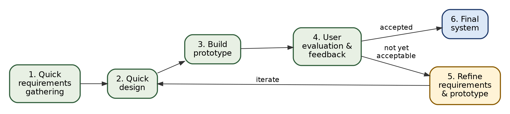

*Figure 1. Prototyping model cycle used for Foresight*

### 3.1 Reasons for choosing the Prototyping Model

- **Requirements were not fully clear at the start.** Details such as which sounds to detect, how threat score and ACI should be combined, and what the dashboard must show could only be settled by trying them.
- **Hardware validation.** Running the software with simulated beacons lets the whole pipeline be built and demonstrated first, and real hardware can be plugged into the same pipeline later.
- **Early feedback reduces risk.** Uncertain parts – the sound classifier, Wi-Fi audio streaming, the Gemini assistant, Supabase hosting – can be tried and corrected early instead of failing at the end.
- **The prototype evolves into the product.** Simulated and real audio use the same backend pipeline, so the prototype code is reused rather than thrown away.
- **Small team, short timeline.** Two members need a lightweight process that produces visible, working results quickly.

### 3.2 Why not the other models?

**Table 2. Software process model comparison**

| Model | Reason it was not chosen |
| --- | --- |
| Waterfall | Needs complete, frozen requirements up front and delivers working software only at the end; unsuitable when the detection logic and UI are still being discovered. |
| Incremental | Useful, but each increment still assumes stable requirements; we use incremental growth inside the prototyping cycle instead. |
| Spiral | Strong risk analysis but heavy documentation and management effort for a two-person project. |
| Agile / Scrum | Assumes a larger team, regular sprints and a continuously available customer; too much ceremony for this scale. |

<!-- Source PDF page 11 -->

## 4. Requirements Identification (Prototype)

### 4.1 How requirements were identified

Requirements were identified through the prototype itself. Starting from the problem statement and a study of what an acoustic forest monitor must do, a first simulation-only prototype was built (backend, database, simulation, dashboard). Working with it exposed missing and unnecessary features, and each round of feedback updated the requirements below.

**Table 3. Prototype iterations and implementation status**

| Prototype | What it demonstrates | Status |
| --- | --- | --- |
| P1 – Simulation-only software demo | Backend API, audio pipeline (decode → classify → ACI → threat score → fusion → event database), simulation of 2 beacons, /dashboard and /simulation pages, light warm UI, Gemini assistant adapter, firmware starter, environment template. Backend tests and frontend production build pass. | Implemented |
| P2 – Hardware integration | Real ESP32-S3 beacon (INMP441 microphone) streaming audio and heartbeats to the same backend; hardware validation. | Pending |
| P3 – Hosted demo | Supabase database and audio storage, audio cleanup / retention, live Gemini verification, deployment and final documentation. | Pending |

### 4.2 Running user interface

See the final page for screenshots of the running Monitoring Dashboard and Scenario Lab, captured at a 16:10 viewport.

### Prototype risks

The team can use these triggers to decide when to investigate or repeat a test.

**Table 4. Prototype risk register**

| Risk | Observable trigger | Response |
| --- | --- | --- |
| Capture loss | Queue‐full or Wi‐Fi errors in the serial log | Repeat capture during congestion and compare received event IDs with the device log. |
| Missed or false alerts | Labelled demo sounds repeatedly cross the wrong side of the threshold | Compare confidence, ACI and final score. Recheck threshold changes with the same clips. |
| Sparse coverage | Few configured zones report recent audio | Show monitored‐zone coverage alongside health. Investigate inactive beacons before interpreting trends. |
| Hardware integration | A host test passes but the device has no corresponding capture | Run the on‐board checklist with microphone, display and Wi‐Fi before claiming field readiness. |

<!-- Source PDF page 12 -->

### 4.3 Functional requirements

**Table 5. Functional requirements and priorities**

| ID | Requirement | Priority |
| --- | --- | --- |
| FR1 | The beacon shall capture ambient audio with the INMP441 microphone (16 kHz, mono, 16-bit WAV, 5‐second clips) and upload it to the backend about every 7 seconds. | High |
| FR2 | The beacon shall send a heartbeat (beacon ID and battery percentage) about every 12 seconds. | High |
| FR3 | The backend shall receive uploaded audio, decode it and resample it as required, without blocking other requests (background workers). | High |
| FR4 | The system shall classify each clip into a sound class with a confidence value (chainsaw, gunshot, explosion, vehicle, engine, chopping or a natural sound), using YAMNet when available and a deterministic fallback otherwise. | High |
| FR5 | The system shall compute the Acoustic Complexity Index (ACI) of each clip. | High |
| FR6 | The system shall compute a threat score from class weights and confidence, and a final score = 0.7 × threat score + 0.3 × ACI drop. Natural sounds have zero threat weight. | High |
| FR7 | The system shall store each event (beacon, server timestamp, class, confidence, threat score, ACI, final score, signal strength, audio URL, confirmation flag) and optionally store the audio clip. | High |
| FR8 | The system shall correlate events from different beacons and record the related events and the strongest-signal beacon. | Medium |
| FR9 | The system shall keep the last heartbeat and battery level of each beacon and derive active/inactive state from a timeout. | High |
| FR10 | The dashboard shall show a map of beacons, beacon state, event feed, filters, ACI chart, forest health, correlation details and audio replay, and update live through WebSocket. | High |
| FR11 | The operator shall be able to review and filter correlated events. | Medium |
| FR12 | The simulation page shall let the administrator start/stop the simulation and choose zone, sound (chainsaw, gunshot, vehicle, engine, chopping), duration and trigger; simulated audio shall use the same pipeline as real audio. | High |
| FR13 | The assistant shall answer natural-language questions using only read-only tools (query events, get beacon status, get ACI trend), with a local fallback when Gemini is unavailable. | Medium |
| FR14 | The administrator shall be able to define beacon coordinates and zones through a configuration file. | Medium |

<!-- Source PDF page 13 -->

**REQUIREMENTS  |  IMPLEMENTATION BASELINE**

## Hardware and software

The physical beacon and Scenario Lab supply audio to the same analysis pipeline. Both modes use the backend, a database, and the browser dashboard.

**Table 6. Hardware and software requirements**

| Component | Physical beacon | Simulation |
| --- | --- | --- |
| Compute and audio input | ESP32-S3 with INMP441 I²S microphone, power, and Wi-Fi connectivity. | Host runs the backend and uses bundled or generated audio. |
| Local waveform display | 128 × 64 SSD1306 OLED, connected over I²C. | Dashboard playback and waveform run in the browser. |
| Firmware build | ESP32 Arduino core, Arduino IDE or CLI, Adafruit SSD1306 and GFX libraries. | Runs without a firmware build. |
| Backend and audio | Python with FastAPI, Uvicorn and the project audio dependencies. YAMNet or the configured fallback supplies classification. | Same backend and classifier or fallback. |
| Dashboard | Node.js 22 and npm to build with Vite. React dashboard runs in a browser. | Same dashboard, with Scenario Lab enabled. |
| Data persistence | SQLite for local runs or configured PostgreSQL. Local storage for eligible recordings. | Same database and recording storage. |
| Optional integrations | Supabase Storage for remote clips and Gemini for assistant responses when configured. | Same optional integrations. |

The demonstration host needs access to the backend. The physical beacon also needs network access to the ingestion API. The assistant has a local-data response mode when the provider is unavailable.

Sources: README.md, backend/.env.example, frontend/package.json and beacon firmware

<!-- Source PDF page 14 -->

### 4.4 Non-functional requirements

**Table 7. Non‐functional requirements**

| ID | Category | Requirement |
| --- | --- | --- |
| NFR1 | Cost | Use low-cost components (ESP32-S3, one INMP441 microphone, LiPo battery) and free-tier hosting for the demo. |
| NFR2 | Performance / latency | Near-real-time detection: an event should reach the dashboard within a few seconds of the sound; inference must not block the API event loop. |
| NFR3 | Reliability | The beacon reconnects to Wi-Fi automatically; a missed heartbeat marks a beacon inactive instead of crashing the system. |
| NFR4 | Security | The Gemini API key stays on the backend only; secrets are kept in environment variables and never committed; the assistant has no database-write, simulation-control or hardware-control ability. |
| NFR5 | Usability | A clear, light-palette interface with a collapsible sidebar; simple simulation controls usable without technical training. |
| NFR6 | Portability / scalability | Runs locally with SQLite and on hosted PostgreSQL (Supabase); adding a beacon needs only a configuration entry. |
| NFR7 | Maintainability | Modular backend (FastAPI, SQLAlchemy) and separate frontend routes; the same pipeline serves real and simulated beacons. |
| NFR8 | Resource limits | Limit incoming audio to the configured byte ceiling (default 10,000,000 bytes per upload). Retention cleanup remains a deployment requirement. |

## 5. External Entities and Actors (Users)

**Table 8. External actors and responsibilities**

| Entity / actor | Type | Role and interaction with the system |
| --- | --- | --- |
| Forest Ranger / Monitoring Officer | Human user (primary) | Watches the dashboard, filters and reviews events, replays audio, reviews confirmations, asks the assistant questions and views forest health. |
| System Administrator | Human user | Runs and edits the simulation, and maintains beacon coordinates and configuration. |
| Acoustic Beacon (real ESP32-S3; simulated beacons) | Hardware / external device | Sends audio clips and heartbeats to the backend. Simulated beacons are generated by the simulation module but use the same interface. |
| Gemini AI Service | External system (secondary actor) | Receives prompts and read-only tool results and returns tool-call requests and generated answers for the assistant. |

**Supporting services** (not drawn as separate entities in the DFD because they act as storage or libraries): Supabase (hosted PostgreSQL and audio storage, with local SQLite and uploads/ as fallback), OpenStreetMap tiles for the map, and the optional TensorFlow Hub YAMNet model for classification.

<!-- Source PDF page 15 -->

**6   |   SOFTWARE REQUIREMENTS SPECIFICATION**

### 6.1  Introduction

#### 6.1.1   Purpose

This specification defines what the Foresight prototype must accept, compute, store and show. A developer can use it to implement the beacon and monitoring interfaces. A tester can use the stated limits and outcomes to check them.

#### 6.1.2   Scope

The system covers acoustic capture, heartbeat reception, classification, event correlation, replay and monitoring in a browser. Scenario Lab exercises the same processing pipeline with simulated inputs. Field deployment and ecological validation are outside the demonstrated scope.

#### 6.1.3   Definitions, acronyms and abbreviations

SRS means software requirements specification. ACI means Acoustic Complexity Index. PCM means pulse‐code modulation. WAV is the audio container used by the beacon. JWT means JSON Web Token. The glossary in §6.4.1 defines the monitoring terms used in this report.

#### 6.1.4   References

The course guidelines of 30 July 2024 specify Jalote, An Integrated Approach to Software Engineering, third edition, §§3.3.1–3.3.2 and 3.3.4. Figures 3.13 and 3.14 give the document structure. Implementation sources are the beacon sketch, beacons\_config.json, backend/app and frontend/src.

#### 6.1.5   Overview

Section 6.2 describes the operating environment and project boundaries. Section 6.3 gives observable requirements and limits. Section 6.4 defines domain terminology. Section 6.5 traces data across the system boundary and between processes.

<!-- Source PDF page 16 -->

**6   |   SOFTWARE REQUIREMENTS SPECIFICATION**

### 6.2  Overall description

#### 6.2.1   Product perspective

An ESP32‐S3 uploads recordings over Wi‐Fi. The simulator can supply equivalent inputs. A shared backend scores each clip, stores the event and publishes updates. The browser reads event history and subscribes to live changes.

#### 6.2.2   Product functions

The operator signs in, checks beacon status and coverage, filters events, replays available recordings and inspects cross‐beacon matches. Scenario Lab sends a supported sound to simulated beacons in a selected zone. The assistant answers read‐only questions about monitoring data.

#### 6.2.3   User characteristics

A monitoring officer needs to read the zone map, distinguish an isolated detection from a correlation, and locate the relevant recording. A demonstration operator also needs to select a zone and interpret scenario status. The maintainer provisions coordinates and service configuration. These are responsibilities exercised through a shared operator login.

#### 6.2.4   Constraints

The supplied registry has ten beacons, one flagged as physical and nine simulated. The UI divides the demonstration map into 16 zones. A single microphone supplies the acoustic signal. The strongest‐beacon estimate does not provide a source bearing.

#### 6.2.5   Assumptions and dependencies

The host provides a writable database and recording directory. The physical beacon needs power, microphone input, Wi‐Fi and a reachable API. Hosted audio and Gemini require their own configuration. Local recording storage and the assistant’s local response path support demonstrations.

#### 6.2.6   Apportioning of requirements

The software baseline includes ingestion, scoring, automatic correlation, login, replay and simulation. Board‐level capture and reconnection require the physical checks listed in the testing appendix. Field accuracy and end‐to‐end field latency require deployment measurements.

<!-- Source PDF page 17 -->

**6   |   SOFTWARE REQUIREMENTS SPECIFICATION**

### 6.3  Specific requirements

#### 6.3.1   Functional requirements

FR1–FR14 define the feature baseline. For a registered beacon, an accepted capture shall produce a scored event. With default settings, a final score of at least 0.60 shall save the clip. An event scoring at least 0.45 shall be compared with qualifying events from other beacons in the preceding 20 seconds. A match shall mark the events confirmed. The operator shall be able to filter by confirmation status.

#### 6.3.2   External interface requirements

The beacon shall submit multipart audio to POST /api/ingest/audio and JSON status to POST /api/ingest/heartbeat. The API shall return 201 and an event for an accepted upload, 404 for an unknown beacon and 413 for an oversize clip. The dashboard shall use authenticated REST requests for history and /ws for live updates. The operator shall use /dashboard for monitoring and /simulation for Scenario Lab.

#### 6.3.3   Performance requirements

The physical firmware shall capture five seconds of mono 16‐bit PCM at 16 kHz on a nominal seven‐second trigger interval. Its heartbeat interval is 12 seconds. With the default timeout, a beacon becomes inactive after 45 seconds without a heartbeat. GET /api/events shall accept a limit from 1 to 500, defaulting to 100. Field upload‐to‐display latency remains to be measured.

#### 6.3.4   Design constraints

The API shall reject audio above its configured byte ceiling (default 10,000,000 bytes). Simulation zones shall match zone\_0\_0 through zone\_3\_3. Trigger duration shall be 0.1–300 seconds inclusive. The server assigns the event timestamp so that correlation does not rely on synchronized device clocks.

#### 6.3.5   Software system attributes

Protected requests shall require a valid operator session. An expired token shall be rejected. A missing recording shall leave the event available for inspection. The interface shall distinguish missing health observations from a measured zero. The host test suites exercise these properties, while physical recovery is covered by the on‐board checklist.

<!-- Source PDF page 18 -->

**6   |   SOFTWARE REQUIREMENTS SPECIFICATION**

### 6.4  Appendices

#### 6.4.1   Glossary

These terms distinguish what a beacon captured, what the backend inferred and what an officer can verify from the dashboard.

**Table 9. Glossary of monitoring terms**

| Term | Meaning in Foresight |
| --- | --- |
| Acoustic capture | One block of microphone or simulated audio passed to the analysis pipeline. |
| ACI | Acoustic Complexity Index. A measure of variation in the soundscape used in scoring and trend displays. |
| Beacon | A registered physical or simulated source of audio and status, identified by its beacon ID. |
| Confirmed event | An event automatically associated with a qualifying event from another beacon within the correlation window. |
| Correlation | A stored group of matched event IDs with a timestamp and the strongest‐signal beacon ID. |
| Detection | A stored classification and score for a capture. An isolated detection can remain unconfirmed. |
| Final score | A bounded score combining threat evidence (70%) and the relative drop in ACI (30%). |
| Heartbeat | A status message. The server records receipt time and uses its age to determine activity. |
| Recorded clip | Audio retained for replay when the final score reaches the save threshold. |
| Zone | One cell in the configured demonstration grid. A simulation trigger addresses beacons assigned to that cell. |

<!-- Source PDF page 19 -->

### 6.5 Data flow models and data dictionary

Notation: circles are processes, rectangles are external entities, and open-ended bars are data stores. Data-flow names match the data dictionary in section 6.5.3.

#### 6.5.1 Level 0 DFD (context diagram)

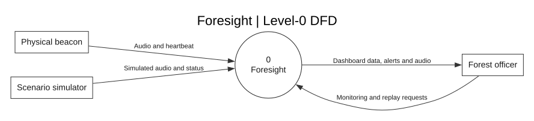

*Figure 2. Level 0 DFD – Foresight as a single process*

#### 6.5.2 Level 1 DFD

Figure 3 (next page) decomposes the Foresight process into seven sub‐processes and five data stores. The main pipeline is 1.0 → 2.0 → 3.0 → 4.0; process 5.0 serves the ranger, 6.0 drives the simulated beacons and 7.0 handles assistant questions.

**Table 10. Level 1 processes, inputs and outputs**

| Process | Description | Inputs | Outputs |
| --- | --- | --- | --- |
| 1.0 Ingest Beacon Data | Receives audio and heartbeats, checks the beacon against the registry, applies the server timestamp, decodes/resamples audio and updates battery and heartbeat data. | AudioClip, Heartbeat, SimAudioClip, SimHeartbeat, BeaconInfo | DecodedAudio, BeaconStatus |
| 2.0 Classify & Analyse Audio | Runs the classifier (YAMNet or fallback) and computes ACI and threat score in a background worker. | DecodedAudio | AnalysisResult |
| 3.0 Fuse Score & Record Event | Computes the final score, saves the event and, for threats, the audio clip. | AnalysisResult | EventRecord, ThreatAudio, NewEvent, EventAlert |
| 4.0 Correlate Events | Links related events from different beacons and estimates the strongest-signal beacon. | NewEvent, RecentEvents | CorrelationRecord, CorrelationAlert Confirmed events |
| 5.0 Serve Live Dashboard | Serves map, events, ACI trend, forest health, correlations and replay; pushes live updates and handles event filters. | EventAlert, CorrelationAlert, BeaconInfo, BeaconStatus, EventHistory, Correlations, AudioURL, FilterRequest | DashboardUpdate |
| 6.0 Manage Simulation | Loops ambient audio per zone, swaps a zone to threat audio on trigger, decays simulated batteries and feeds simulated beacons into 1.0. | SimCommand, BeaconConfig, ZoneAudio | SimAudioClip, SimHeartbeat, SimStatus |
| 7.0 Answer Assistant Query | Sends the prompt to Gemini, runs only the allowed read-only tools and returns the answer. | AssistantQuery, ToolCall, LLMResponse, EventData, BeaconStatus | AssistantAnswer, LLMRequest |

<!-- Source PDF page 20 -->

**6.5.2  |  DATA FLOW MODELLING**

## Level 1 data flow diagram

A store or actor shown more than once represents the same store or actor.


Figure 3. Level 1 DFD: seven processes and five logical data stores.

<!-- Source PDF page 21 -->

#### 6.5.3 Data dictionary

Notation: **=** is composed of; **+** and; **\[ a | b \]** either a or b; **( )** optional; **{ }** repeated (zero or more).

### Data flows

**Table 11. Data dictionary of named flows**

| Name | Composition | Description |
| --- | --- | --- |
| AudioClip | BeaconID + WAVAudio | 5‐second, 16 kHz, mono, 16‐bit WAV clip uploaded by the real beacon on a 7‐second schedule. |
| Heartbeat | BeaconID + BatteryPercent | JSON status message from the real beacon about every 12 s. The backend schema permits an omitted or null battery percentage or device timestamp. |
| SimAudioClip | BeaconID + ZoneID + WAVAudio | Clip generated for a simulated beacon from its zone's ambient or threat audio. |
| SimHeartbeat | BeaconID + BatteryPercent | Heartbeat of a simulated beacon; simulated battery decays slowly. |
| SimCommand | \[Start \| Stop \| Trigger\] + ZoneID + SoundType + Duration | Administrator's simulation controls. The schema permits an omitted or null duration where applicable. Explicit durations range from 0.1 to 300 seconds. SoundType = \[chainsaw \| gunshot \| vehicle \| engine \| chopping\]. |
| BeaconConfig | {BeaconID + Latitude + Longitude + IsSimulated} | Manually maintained beacon coordinates (beacons\_config.json). |
| SimStatus | SimRunning + {ZoneID + ZoneState} | Whether the simulation is running and which zones play ambient or threat audio. |
| ZoneAudio | ZoneID + AmbientWAV + (ThreatWAV) | Looping ambient file and generated threat audio for a zone. |
| BeaconInfo | BeaconID + Latitude + Longitude + IsSimulated | Beacon registry data used for validation and map display. |
| BeaconStatus | BeaconID + LastHeartbeat + BatteryPercent | Latest heartbeat data; active/inactive is derived from a timeout. |
| DecodedAudio | BeaconID + ServerTimestamp + Samples | Audio decoded and resampled for analysis. |
| AnalysisResult | SoundClass + Confidence + ACI + ACIDrop + ThreatScore + SignalStrength | Output of classification and analysis for one clip. |
| EventRecord | EventID + BeaconID + Timestamp + SoundClass + Confidence + ThreatScore + ACI + FinalScore + SignalStrength + (AudioURL) + Confirmed | One detected sound event as stored in the events table. |
| NewEvent | EventID + BeaconID + Timestamp + SoundClass + FinalScore + SignalStrength | Notification that a new event was recorded. |
| RecentEvents / EventHistory / EventData | {EventRecord} | Sets of stored events read for correlation, dashboard display and assistant tools. |
| ThreatAudio | EventID + WAVAudio | Audio clip of a threat event kept for replay. |
| AudioURL | \[SupabaseStorageURL \| LocalUploadPath\] | Location of a stored clip. |
| CorrelationRecord | CorrelationID + {EventID} + StrongestBeaconID + Timestamp | Related events and the beacon that heard them most strongly. |
| Correlations | {CorrelationRecord} | Stored correlations read by the dashboard. |
| EventAlert / CorrelationAlert | EventRecord / CorrelationRecord | Live notifications pushed to the dashboard over WebSocket. |
| FilterRequest | (BeaconID) + (SoundClass) + (TimeRange) + (MinScore) | Filters chosen by the ranger. |
| Confirmed events | {EventID + Confirmed} | Set automatically for matched events by the correlation process. |

<!-- Source PDF page 22 -->

**Table 11. Data dictionary of named flows (continued)**

| Name | Composition | Description |
| --- | --- | --- |
| DashboardUpdate | {EventRecord} + {BeaconStatus} + ACITrend + ForestHealth + {CorrelationRecord} | Data shown to the ranger. |
| ACITrend | BeaconID + {Timestamp + ACI} | ACI values over time. |
| AssistantQuery / AssistantAnswer | PromptText / AnswerText | Question typed by the ranger and the reply. |
| LLMRequest | PromptText + (ToolResults) | Request sent to the Gemini service. |
| ToolCall / LLMResponse | ToolName + Parameters / \[AnswerText \| ToolCall\] | ToolName = \[query\_events \| get\_beacon\_status \| get\_aci\_trend\]. |

### Data stores

**Table 12. Logical data stores**

| Store | Composition | Notes |
| --- | --- | --- |
| D1 Beacon Registry | {beacons: BeaconID + Latitude + Longitude + IsSimulated} + {beacon\_status: BeaconID + LastHeartbeat + BatteryPercent} | beacons and beacon\_status tables. |
| D2 events | {EventRecord} | Sound events with scores; SQLite locally, Supabase PostgreSQL when hosted. |
| D3 correlations | {CorrelationRecord} | Related event IDs, strongest-signal beacon estimate and timestamp. |
| D4 audio store | {ThreatAudio} | Supabase Storage, or local uploads/ folder when Supabase is not configured. |
| D5 zone audio library | {ZoneAudio} | Ambient WAV files in backend/audio/zones/. |

### Data elements

**Table 13. Elementary data definitions**

| Element | Definition |
| --- | --- |
| BeaconID | Non-empty text identifier of up to 64 characters, e.g. BEACON\_01. |
| ZoneID | zone\_r\_c, with row r and column c in 0–3 (16 zones). |
| Latitude / Longitude | Latitude −4.15 to −3.85; longitude −55.20 to −54.90. |
| BatteryPercent | 0–100 %, calibrated from 3.20 V (empty) to 4.20 V (full). |
| SoundClass | \[chainsaw \| gunshot \| explosion \| vehicle \| engine \| chopping \| natural sound\]. |
| Class weights | Chainsaw 0.9, gunshot 1.0, explosion 1.0, vehicle 0.6, engine 0.5, chopping 0.7; natural sounds 0. |
| FinalScore | 0.7 × ThreatScore + 0.3 × ACIDrop. |
| ServerTimestamp | Time assigned by the backend when the data arrives (device time is not trusted). |
| ACI | Acoustic Complexity Index. |
| Capture source | Audio upload or heartbeat. An audio upload contains the beacon ID and audio file. |
| Recording or latest capture | A saved recording or the latest capture. Latest capture contains beacon ID, capture ID, audio samples, and metadata. |
| Event history | A list of scored event records. The list may be empty. |
| Accepted scenario | The simulation status can include the accepted scenario. |
| Assistant request and reply | A request contains a prompt, optional selection, and conversation history. History can be empty. Each turn contains a role and message. A reply contains answer text and a possibly empty list of evidence references. |

Schema definitions use omitted or null values where permitted. Source: Jalote, 3rd ed., §3.2.2, pp. 94–95, Fig. 3.3, and backend/app/schemas.py.

<!-- Source PDF page 23 -->

**7  |  REQUIREMENTS ANALYSIS**

## Use case diagram

Solid lines connect actors to the use cases they participate in.

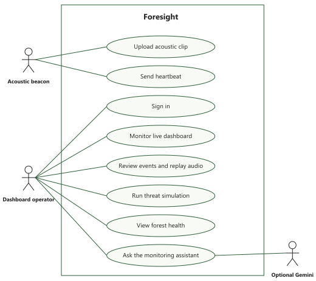

Figure 4. Actor associations for the implemented Foresight workflows.

Jalote, 3rd ed., §§3.4.1–3.4.2  |  Implementation: backend/app/main.py and auth.py

<!-- Source PDF page 24 -->

### Use case list

**Table 14. Use case catalogue**

| ID | Use case | Actor(s) | Summary |
| --- | --- | --- | --- |
| UC-01 | Detect & Classify Threat | Acoustic Beacon | Analyse an uploaded clip, score it, store the event and notify the dashboard. Includes UC-04 and UC-06. |
| UC-02 | Monitor Live Dashboard | Forest Ranger | View map, beacon state, events and live updates. Includes UC-10. |
| UC-03 | Run Threat Simulation | System Administrator | Start simulated beacons and trigger threat sounds in a zone. |
| UC-04 | Capture & Upload Audio | Acoustic Beacon | Record a 5‐second clip and send it to the backend. |
| UC-05 | Send Heartbeat | Acoustic Beacon | Report beacon ID and battery percentage. |
| UC-06 | Correlate Events Across Beacons | (included in UC-01) | Link related events and estimate the strongest-signal beacon. |
| UC-07 | Filter & Review Events | Forest Ranger | Filter events by beacon, sound, time and score. |
| UC-08 | Replay Threat Audio | Forest Ranger | Extends UC-07: listen to the stored clip of an event. |
| UC-09 | Review Confirmation | Forest Ranger | Inspect the event’s correlation status. |
| UC-10 | View Forest Health (ACI Trend) | Forest Ranger | See ACI over time and overall soundscape health. |
| UC-11 | Ask AI Assistant | Forest Ranger, Gemini AI Service | Ask questions answered through read-only tools. |
| UC-12 | Configure Beacons & Zones | System Administrator | Maintain beacon coordinates and zone configuration. |

## 8. Use Case Templates (Core Functionality)

The three use cases below cover the core functionality of Foresight: detecting threats (backend), monitoring them (users) and running the demo without hardware (simulation).

<!-- Source PDF page 25 -->

<table>
<caption>Table 15. UC‐01 detection and classification template</caption>
<thead><tr><th colspan="2">Use Case UC-01: Detect &amp; Classify Threat</th></tr></thead>
<tbody>
<tr><th>Use case ID / name</th><td>UC-01 – Detect &amp; Classify Threat</td></tr>
<tr><th>Primary actor</th><td>Acoustic Beacon (real or simulated)</td></tr>
<tr><th>Secondary actor</th><td>Forest Ranger (receives the resulting alert)</td></tr>
<tr><th>Description</th><td>The backend analyses an audio clip from a beacon, decides whether it contains a threat sound, measures soundscape health, records the event, correlates it with other beacons and updates the dashboard.</td></tr>
<tr><th>Trigger</th><td>A beacon uploads a 5‐second audio clip (about every 7 seconds).</td></tr>
<tr><th>Preconditions</th><td>1. Backend is running and reachable over the local network.<br>2. The beacon is listed in the beacon configuration.<br>3. A classifier is available (YAMNet, or the deterministic fallback).</td></tr>
<tr><th>Main flow</th><td>1. Beacon records a 5‐second clip (16 kHz, mono, 16‐bit) and uploads it with its beacon ID.<br>2. System checks the beacon ID against the registry and applies the server timestamp.<br>3. System decodes and resamples the audio and passes it to a background worker.<br>4. System classifies the sound and obtains a sound class and confidence.<br>5. System computes the ACI of the clip.<br>6. System computes the threat score (class weight and confidence) and the ACI drop, then final score = 0.7 × threat score + 0.3 × ACI drop.<br>7. System stores the scored event and optionally saves eligible audio and its URL. Below the save threshold, the event is recorded without a saved clip.<br>8. System compares the event with recent events of other beacons and, if related, records a correlation with the strongest-signal beacon.<br>9. System publishes the event and any correlation over WebSocket and returns the event record. An event with no qualifying match remains unconfirmed.</td></tr>
<tr><th>Alternative flows</th><td>A1 – Natural sound: the event is stored with zero threat score and contributes to ACI and forest health; no alert is raised.<br>A2 – TensorFlow/YAMNet unavailable: the deterministic local classifier is used.<br>A3 – Supabase not configured: audio is saved to the local uploads/ folder.</td></tr>
<tr><th>Exceptions</th><td>E1 – Unknown beacon ID: the API returns HTTP 404 and nothing is stored.<br>E2 – Corrupt or unreadable WAV: the upload is rejected and the error is logged.<br>E3 – Wi-Fi lost: the beacon reconnects and continues with the next clip; missing heartbeats mark it inactive.<br>E4 – Database write fails: the error is logged and the dashboard is not updated for that clip.<br>E5 – Oversize audio: the API returns HTTP 413 before decoding.</td></tr>
<tr><th>Postconditions</th><td>Success: the event record (class, confidence, threat score, ACI, final score) is stored; any correlation is stored; the dashboard shows the update. Failure: no partial event is shown.</td></tr>
<tr><th>Priority / frequency</th><td>High priority; continuous – roughly one clip per beacon every 7 seconds.</td></tr>
<tr><th>Business rules / notes</th><td>Server timestamps are trusted instead of device timestamps. Natural sounds have zero threat weight. No direction estimation (one microphone).</td></tr>
</tbody>
</table>

<!-- Source PDF page 26 -->

<table>
<caption>Table 16. UC‐02 monitoring dashboard template</caption>
<thead><tr><th colspan="2">Use Case UC-02: Monitor Live Dashboard</th></tr></thead>
<tbody>
<tr><th>Use case ID / name</th><td>UC-02 – Monitor Live Dashboard</td></tr>
<tr><th>Primary actor</th><td>Forest Ranger / Monitoring Officer</td></tr>
<tr><th>Related use cases</th><td>Includes UC-10 (View Forest Health). Extended by UC-07 (Filter &amp; Review Events), UC-08 (Replay Threat Audio) and UC‐09 (Review Confirmation).</td></tr>
<tr><th>Description</th><td>The ranger watches the live state of all beacons and detected events on a map dashboard and reacts to threats.</td></tr>
<tr><th>Trigger</th><td>The ranger opens /dashboard in a web browser.</td></tr>
<tr><th>Preconditions</th><td>1. Backend and frontend are running.<br>2. At least one beacon (real or simulated) is configured.<br>3. The operator has a valid session.</td></tr>
<tr><th>Main flow</th><td>1. Ranger opens the dashboard.<br>2. System loads the beacon registry and shows the map with beacons at their configured coordinates on the 4 × 4 zone grid.<br>3. System shows each beacon&#x27;s state (active/inactive from heartbeat timeout) and battery level.<br>4. System loads recent events into the event feed and shows the ACI chart and forest health (UC-10).<br>5. System opens a WebSocket connection for live updates.<br>6. When a new event arrives, the feed and map update immediately and threats are highlighted.<br>7. Ranger selects an event to see its details and any correlated events from other beacons.</td></tr>
<tr><th>Alternative flows</th><td>A1 – Ranger applies filters (beacon, sound class, time, score) and the feed and map update (UC-07). Event history is empty when no results match.<br>A2 – Ranger replays the stored audio (UC‐08) or reviews its confirmation (UC‐09).<br>A3 – Ranger collapses or expands the left sidebar.</td></tr>
<tr><th>Exceptions</th><td>E1 – WebSocket disconnects: the dashboard shows the connection problem and reloads data when reconnected.<br>E2 – No heartbeat within the timeout: the beacon is shown as inactive.<br>E3 – Backend unreachable: an error state is shown instead of stale data.<br>E4 – Event has no stored audio: the replay option is not offered.<br>E5 – Session rejected: the client returns to sign-in.<br>E6 – No correlation match: correlation details are empty.</td></tr>
<tr><th>Postconditions</th><td>The ranger sees the current status of the forest and can act on new threats; confirmed events are saved with their confirmation flag.</td></tr>
<tr><th>Priority / frequency</th><td>High priority; used continuously during monitoring.</td></tr>
</tbody>
</table>

<!-- Source PDF page 27 -->

<table>
<caption>Table 17. UC‐03 threat simulation template</caption>
<thead><tr><th colspan="2">Use Case UC-03: Run Threat Simulation</th></tr></thead>
<tbody>
<tr><th>Use case ID / name</th><td>UC-03 – Run Threat Simulation</td></tr>
<tr><th>Primary actor</th><td>System Administrator (signed-in dashboard operator)</td></tr>
<tr><th>Secondary actor</th><td>Simulated beacons (part of the system)</td></tr>
<tr><th>Description</th><td>The administrator uses the simulation page to run simulated beacons and trigger threat sounds in a chosen zone, so the full detection pipeline can be demonstrated without the hardware.</td></tr>
<tr><th>Trigger</th><td>The administrator opens /simulation and starts the simulation.</td></tr>
<tr><th>Preconditions</th><td>1. Backend is running with simulation enabled (ENABLE_SIMULATION=true).<br>2. Ambient WAV files exist for the zones in backend/audio/zones/.<br>3. Simulated beacons are configured.<br>4. The dashboard operator has a valid session.</td></tr>
<tr><th>Main flow</th><td>1. Administrator opens /simulation; the system shows the controls and zone activity.<br>2. Administrator starts the simulation; each zone loops its ambient audio and simulated beacons send clips and heartbeats.<br>3. Administrator selects a zone, a sound (chainsaw, gunshot, vehicle, engine or chopping) and a duration.<br>4. Administrator presses Trigger. Foresight validates the request and returns the accepted scenario.<br>5. System cleanly swaps that zone from ambient audio to generated threat audio.<br>6. Simulated clips enter the normal pipeline (UC-01) and events appear on the dashboard.<br>7. After the chosen duration the zone returns to ambient audio.<br>8. Administrator stops the simulation when finished.</td></tr>
<tr><th>Alternative flows</th><td>A1 – Administrator edits zone activity while the simulation runs.<br>A2 – Administrator stops during a threat: the zone returns to ambient and the loop halts.</td></tr>
<tr><th>Exceptions</th><td>E1 – Simulation disabled: Start returns HTTP 404 and the controls report that simulation is unavailable.<br>E2 – Ambient file missing: the zone cannot start and an error is shown.<br>E3 – Unsupported sound, simulator stopped, or zone without a simulated beacon: Trigger returns HTTP 400.<br>E4 – Invalid zone format or duration: Trigger returns HTTP 422.<br>E5 – The simulator can generate fallback audio for a missing or invalid scenario clip.</td></tr>
<tr><th>Postconditions</th><td>Threat events created by the simulation are stored and visible on the dashboard; zones are back to ambient audio after the trigger ends.</td></tr>
<tr><th>Priority / frequency</th><td>High priority for the demo; once per demonstration or test session.</td></tr>
<tr><th>Business rules / notes</th><td>Simulated and real audio use the same backend pipeline. Simulated batteries slowly decay.</td></tr>
</tbody>
</table>

Jalote, An Integrated Approach to Software Engineering, 3rd ed., §§3.4.1–3.4.2

<!-- Source PDF page 28 -->

**IMPLEMENTATION  |  WORKING MODULE**

## Login and protected access

### Architecture

The React sign-in form sends an ID and password to POST /api/auth/login. FastAPI validates the request schema. The login handler checks server configuration and compares the supplied credentials with the configured credentials.

### Credential configuration

**Table 18. Operator authentication settings**

| Setting | Illustrative value | Purpose |
| --- | --- | --- |
| FORESIGHT\_LOGIN\_ID | \<operator-id\> | Identifies the configured operator. |
| FORESIGHT\_LOGIN\_PASSWORD | \<operator-password\> | Server-side credential checked on sign-in. |
| FORESIGHT\_JWT\_SECRET | \<random-secret-at-least-32-bytes\> | HS256 signing secret. The code requires at least 32 encoded bytes. |

### How a session runs

1. Successful sign-in returns a bearer JWT with a one-hour expiry and sets Cache-Control to no-store. The token includes the issuer, subject, issued-at time, and expiry.
2. The browser stores the token in the current tab’s sessionStorage. For protected HTTP calls it sends Authorization: Bearer \<token\>. The WebSocket sends the token during its authentication exchange.
3. The backend verifies the JWT signature and required claims. GET /api/auth/session returns the expiry. A valid session allows protected requests to read monitoring records through the API.

### Credential and data storage

The operator credentials and signing key are supplied through backend configuration. The monitoring database stores beacon, status, event, and correlation records. Foresight’s implemented access workflow is sign-in and session validation.

Sources: backend/app/auth.py, backend/app/main.py, backend/.env.example and frontend/src/services/api.js

<!-- Source PDF page 29 -->

**IMPLEMENTATION  |  DATA MODEL**

## Monitoring database schema

Primary keys identify table rows. Solid connectors show declared foreign keys. Dashed connectors show application associations.

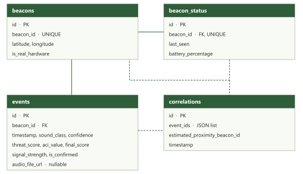

**Figure 5. Monitoring database schema**

**Table 19. Database relationships and keys**

| Relationship | Implementation |
| --- | --- |
| Beacon → status | Zero or one status row per beacon. UNIQUE foreign key references beacons.beacon\_id. |
| Beacon → events | Zero or many event rows per beacon. Foreign key references beacons.beacon\_id. |
| Correlation → events | Event IDs are stored in JSON and resolved by application logic. |
| Correlation → nearest beacon | Stored beacon identifier resolves through application logic. |

Source: backend/app/models.py  |  PK = primary key  ·  FK = declared foreign key

<!-- Source PDF page 30 -->

**IMPLEMENTATION  |  WORKING MODULE**

## Login source code

These excerpts come from backend/app/auth.py. The first shows credential checks and token issuance. The second shows token verification for protected access.

### POST /api/auth/login

```python
@router.post('/login')
def login(payload: Login, settings: AppSettings, response: Response):
    secret = signing_key(settings)
    valid_id = compare_digest(payload.login_id.encode(), settings.foresight_login_id.encode())
    valid_password = compare_digest(
        payload.password.get_secret_value().encode(),
        settings.foresight_login_password.get_secret_value().encode(),
    )
    if not (valid_id and valid_password):
        raise unauthorized('Invalid login ID or password')
    now = int(datetime.now(timezone.utc).timestamp())
    token = jwt.encode(
        {'iss': ISSUER, 'sub': settings.foresight_login_id, 'iat': now, 'exp': now + TOKEN_SECONDS},
        secret, algorithm='HS256',
    )
    response.headers['Cache-Control'] = 'no-store'
    return {'access_token': token, 'token_type': 'bearer', 'expires_in': TOKEN_SECONDS}
```

### Token verification

```python
def verify_token(token: str, settings: Settings) -> int:
    try:
        claims = jwt.decode(
            token, signing_key(settings), algorithms=['HS256'], issuer=ISSUER,
            subject=settings.foresight_login_id,
            options={'require': ['iss', 'sub', 'iat', 'exp']},
        )
    except jwt.InvalidTokenError as exc:
        raise unauthorized() from exc
    return claims['exp']
```

The request dependency rejects missing bearer credentials before calling verify\_token(). The verifier returns the expiry from the validated token.

Source: backend/app/auth.py  |  Login route and verify\_token()

<!-- Source PDF page 31 -->

**9  |  WHITE-BOX TESTING**

## Login pseudocode

Module under test: POST /api/auth/login and the signing\_key helper. The analysis starts with a schema-valid request. Each bracketed number identifies a node in the control-flow graph in Figure 6.

```text
[1] PROCEDURE Login(request, settings)
[2]   IF configured login ID is blank: GOTO 8
[3]   IF configured password is empty: GOTO 8
[4]   IF UTF-8 signing key is shorter than 32 bytes: GOTO 8
[5]   id_matches = secure_compare(request.ID, configured.ID)
      password_matches = secure_compare(request.password,
                                         configured.password)
[6]   IF id_matches is false: GOTO 9
[7]   IF password_matches is false: GOTO 9
[10]  Issue HS256 JWT with issuer, subject, iat and exp
      Set expiry to issue time + 3600 seconds
      Set Cache-Control to no-store; return HTTP 200; GOTO 11
[8]   Return HTTP 503 (login unconfigured); GOTO 11
[9]   Return HTTP 401 (invalid credentials); GOTO 11
[11] END PROCEDURE
```

The configuration checks short-circuit in order. Both credential comparisons execute at node 5 before the combined credential check branches. The graph uses one exit for all three HTTP outcomes.

Implementation: backend/app/auth.py  |  Aggarwal and Singh, 3rd ed., §8.4.2

<!-- Source PDF page 32 -->

**9  |  WHITE-BOX TESTING**

## Cyclomatic flow graph

Each circle represents a basic block or predicate. T and F label the predicate outcomes. The graph has a single entry and exit.

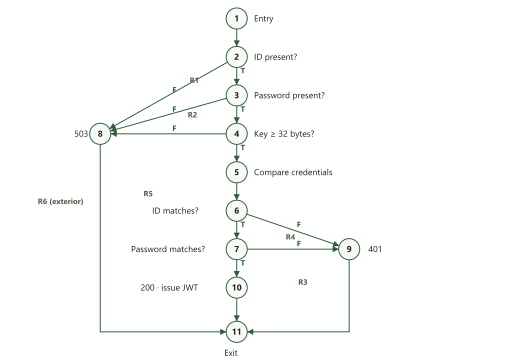

**Figure 6. Control‐flow graph for operator login**

### Three calculations

**Table 20. Cyclomatic complexity by three methods**

| Method | Substitution | V(G) |
| --- | --- | --- |
| Edges, nodes and components | E − N + 2C = 15 − 11 + 2(1) | 6 |
| Binary predicates | Π + 1 = 5 + 1 | 6 |
| Regions | 5 bounded regions + 1 exterior region | 6 |

Aggarwal and Singh, Software Engineering, 3rd ed., §8.4.2, pp. 422–425

<!-- Source PDF page 33 -->

**9  |  WHITE-BOX TESTING**

## Independent basis paths

Each path introduces an edge absent from all preceding paths. Use isolated settings and synthetic credentials. Hold the request schema valid across all six cases.

**Table 21. Independent login paths and evidence**

| Case | Node sequence | Condition and expected outcome | Evidence |
| --- | --- | --- | --- |
| P1 | 1–2–8–11 | Configured ID blank. HTTP 503. | Designed |
| P2 | 1–2–3–8–11 | Configured ID present and password empty. HTTP 503. | Designed |
| P3 | 1–2–3–4–8–11 | ID and password configured. Key shorter than 32 bytes. HTTP 503. | Recorded |
| P4 | 1–2–3–4–5–6–9–11 | Valid configuration. Submit wrong ID and correct password. HTTP 401. | Recorded in report |
| P5 | 1–2–3–4–5–6–7–9–11 | Valid configuration. Submit correct ID and wrong password. HTTP 401. | Recorded in report |
| P6 | 1–2–3–4–5–6–7–10–11 | Valid configuration and credentials. HTTP 200 with bearer token. | Recorded in report |

New edges in order include 2→8, 3→8, 4→8, 6→9, 7→9, and 7→10. Together the paths cover all 15 edges.

Recorded evidence comes from the existing Foresight report and its sanitized test log. The paths in this appendix were derived by inspecting the current code.

Aggarwal and Singh, 3rd ed., §8.4.2  |  Evidence: project\_file/report.md, §5

<!-- Source PDF page 34 -->

**10  |  BLACK-BOX TESTING**

## Boundary value analysis

### Feature under test  ·  Event history on the Foresight dashboard

Request: GET /api/events?limit=x. The API accepts an integer limit from 1 to 500.

Preconditions: valid bearer session; 501 seeded events with distinct timestamps.

Hold the dataset and session fixed. Leave optional filters unset.

### 1. Derive the test values

Lower limit L = 1     Upper limit U = 500     Nominal N = 100 (the API default)

Normal BVA = {L, L + 1, N, U − 1, U} = {1, 2, 100, 499, 500}

Normal case count = 4n + 1 = 4(1) + 1 = 5, where n = 1 varied input.

Robustness adds {L − 1, U + 1} = {0, 501}. Total = 5 + 2 = 7 cases.

### 2. Compare the API response with the expected outcome

**Table 22. Event‐history boundary value test cases**

| Case | Input x | Boundary position | Expected result |
| --- | --- | --- | --- |
| BV-01 | 1 | L | 200 · 1 newest event |
| BV-02 | 2 | L + 1 | 200 · 2 newest events |
| BV-03 | 100 | N | 200 · 100 newest events |
| BV-04 | 499 | U − 1 | 200 · 499 newest events |
| BV-05 | 500 | U | 200 · 500 newest events |
| BV-06 | 0 | L − 1 | 422 · limit validation error |
| BV-07 | 501 | U + 1 | 422 · limit validation error |

For 200 responses, check the record count and descending timestamp order.

For 422 responses, check that the error identifies the query parameter limit.

**Execution status: designed cases with expected results.**

Aggarwal and Singh, Software Engineering, 3rd ed., §§8.3.1–8.3.2, p. 372 onward

<!-- Source PDF page 35 -->

**TESTING  |  BLACK-BOX COVERAGE**

## Login and session tests

Exercise the HTTP endpoints or WebSocket with an isolated backend and synthetic test credentials. Observe status codes and returned fields.

**Table 23. Login and protected‐session test cases**

| ID and feature | Test input | Expected outcome | Recorded result |
| --- | --- | --- | --- |
| LG-01 · Sign-in | Configured test ID and password. | 200 and a bearer token with one-hour lifetime. | Pass · sign-in fixture and browser sign-in. |
| LG-02 · Credentials | Wrong ID with correct password. Repeat with correct ID and wrong password. | Both return 401 and the same credential message. | Pass · API checks. |
| LG-03 · Required fields | Omit ID and password in separate requests. | 422 identifies the missing field. | Report records 422 on omitted fields. |
| LG-04 · Configuration | Use an empty signing key. | Login returns 503. | Pass · unconfigured login API test. |
| LG-05 · Protected access | Request a recording with no token, then with a valid token. | 401 without the token. Recording body with the valid token. | Pass · session and recording test. |
| LG-06 · Session | Use a valid bearer token at /api/auth/session. | 200 with future expires\_at. | Pass · API test. |
| LG-07 · Token integrity | Use an invalid token on a protected request. | 401 for protected REST. Invalid WebSocket token closes with 4401. | Pass · API and WebSocket tests. |
| LG-08 · Expiry | Wait for a short-lived token to expire. | REST returns 401. Live socket closes with 4401. | Pass · expired-token test. |

Results reference the existing execution record and implementation tests. The seven event-history boundary cases are listed separately in the boundary value section.

Evidence: project\_file/report.md, §5, execution-evidence.txt and backend/tests/test\_api.py

<!-- Source PDF page 36 -->

**11  |  FUNCTION POINT ANALYSIS**

## Information domain count

Boundary: Foresight firmware-facing ingestion and operator-facing application. Count user-facing operations and logical record groups once. The physical and simulated streams use the same processing functions.

**Table 24. Function point components and weights**

| Category | Optim. | Likely | Pess. | Est. | Weight | FP |
| --- | --- | --- | --- | --- | --- | --- |
| External inputs | 6 | 6 | 6 | 6 | 4 | 24 |
| External outputs | 5 | 5 | 5 | 5 | 5 | 25 |
| External inquiries | 10 | 10 | 10 | 10 | 5 | 50 |
| Internal logical files | 5 | 5 | 5 | 5 | 10 | 50 |
| External interface files | 0 | 0 | 0 | 0 | 7 | 0 |
| Count total |  |  |  |  |  | 149 |

All categories use the average weights printed in Table 25.1. The three count scenarios use the same observed inventory because the estimate describes the current release.

### Counted functions

Inputs (6). Sign in, ingest audio, update heartbeat, start simulation, stop simulation, and trigger scenario.

Outputs (5). Event notifications, cross-beacon confirmation alerts, derived forest summary, computed waveform, and assistant response.

Inquiries (10). Session check, beacon registry, beacon status, event history, event detail, correlation detail, ACI history, recorded/latest audio playback, simulation status, and assistant availability.

Internal logical files (5). Beacon registry, beacon status, events, correlations, and saved recordings. Latest capture is transient. Bundled scenario samples, model assets and deployment configuration are implementation resources. No externally maintained logical file is counted. Gemini exchanges messages through a service API.

Pressman and Maxim, 9th ed., §§25.6.1 and 25.6.4, p. 514, Table 25.1

<!-- Source PDF page 37 -->

**11  |  FUNCTION POINT ANALYSIS**

## Effort, duration and cost

Rate the influence of each factor on the prototype from 0 (none) to 5 (very important).

**Table 25. Fourteen function point adjustment factors**

| # | Complexity factor | Score | Foresight rationale |
| --- | --- | --- | --- |
| 1 | Backup and recovery | 1 | Local data can be backed up through the database and recording store. |
| 2 | Data communications | 4 | Wi-Fi audio uploads, REST queries and WebSocket updates are central. |
| 3 | Distributed processing | 2 | The beacon acquires and prepares samples. The backend classifies and scores them. |
| 4 | Performance critical | 3 | Live monitoring needs responsive ingestion, analysis and updates. |
| 5 | Existing operating environment | 2 | Runs with a browser, a Python service and supported embedded hardware. |
| 6 | Online data entry | 4 | Beacon submissions and simulation controls are processed as they arrive. |
| 7 | Input transaction over multiple screens | 2 | Sign-in, monitoring and Scenario Lab use distinct views. |
| 8 | Master files updated online | 4 | Audio and heartbeat requests write monitoring records during operation. |
| 9 | Information domain values complex | 3 | Audio, events, beacon status and correlation records have distinct structures. |
| 10 | Internal processing complex | 4 | Classification, ACI extraction, score fusion and correlation run per capture. |
| 11 | Code designed for reuse | 2 | Physical and simulated captures share the same analysis pipeline. |
| 12 | Conversion and installation in design | 1 | Environment configuration and beacon setup support installation. |
| 13 | Multiple installations | 1 | Local and hosted deployments are possible using the same application. |
| 14 | Application designed for change | 3 | Configurable thresholds and separated modules support iterative changes. |
|  | Total degree of influence | 36 | Sum of the 14 ratings. |

### Function point and lab estimates

**Table 26. Adjusted function points, effort, duration and cost**

| Measure | Calculation | Result |
| --- | --- | --- |
| Unadjusted count | 24 + 25 + 50 + 50 + 0 | 149 |
| Value adjustment factor | 0.65 + 0.01 x sum(Fi) = 0.65 + 0.01 x 36 | 1.01 |
| Adjusted function points | 149 x 1.01 | 150.49 FP |
| Effort | 150.49 FP / 10 FP per person-month | 15.049 person-months |
| Calendar duration | 15.049 person-months / 1 full-time developer | 15.049 months |
| Labour cost | 15.049 person-months x Rs. 50,000 per person-month | Rs. 7,52,450 |

Pressman and Maxim, 9th ed., sec. 25.6.4, pp. 514-515, Tables 25.1-25.2

<!-- Source PDF page 38 -->

**12  |  DESIGN ENGINEERING**

## Structure chart

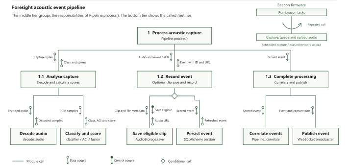

**Figure 7. Structure chart of the acoustic event pipeline**

Persist event runs for both save outcomes.

The parent calls Save eligible clip when the final score meets the recording threshold.

Correlate events applies its own threshold and checks for matches from other beacons.

Aggarwal and Singh, 3rd ed., pp. 218–219, Figs. 5.16–5.18  |  backend/app/pipeline.py

Foresight | Software Engineering Theory Assignment Page 30

<!-- Source PDF page 39 -->

<!-- Source PDF page 40 -->

<!-- Source PDF page 41 -->

<!-- Source PDF page 42 -->

<!-- Source PDF page 43 -->

**13  |  PROJECT MANAGEMENT**

## Gantt chart

### Foresight development timeline · August to November 2026

October sourcing is shown at month precision. Exact dates were not recorded.

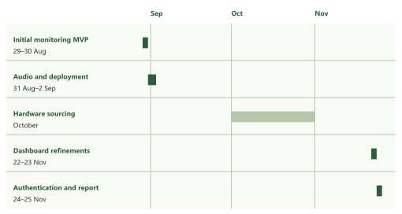

**Figure 8. Development Gantt chart and hardware sourcing**

### Milestones

29–30 Aug  ·  Ingestion, OLED capture and live monitoring

31 Aug–2 Sep  ·  YAMNet deployment and playback

October  ·  Sourced hardware materials for the physical beacon

22–23 Nov  ·  Navigation, health and scenario updates

24–25 Nov  ·  Officer sign-in, testing evidence and report

Sources: dated Git commits and the team’s account of October hardware sourcing.

Schedule presentation: Pressman and Maxim, 9th ed., §25.10

<!-- Source PDF page 44 -->

**14  |  DESIGN ENGINEERING**

## Sequence diagram

### Physical beacon upload and live event delivery

Successful upload with optional clip storage and cross-beacon confirmation.

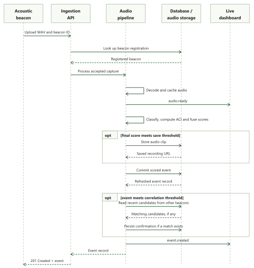

**Figure 9. Sequence diagram for beacon upload and live delivery**

When correlation succeeds, the pipeline also broadcasts event.confirmed.

Saved recordings can be queued for upload to remote storage after publication.

Implementation: backend/app/main.py and backend/app/pipeline.py

<!-- Source PDF page 45 -->

**REFERENCES  |  PROJECT RESOURCES**

## Tools and resources

**Table 27. Project tools and resources**

| Area | Tools and purpose |
| --- | --- |
| Firmware | Arduino IDE or Arduino CLI, ESP32 board support, Adafruit GFX and SSD1306 for beacon capture and display. |
| Backend | Python, FastAPI, Uvicorn, Pydantic, SQLAlchemy and PyJWT for API, persistence and session handling. |
| Acoustic processing | YAMNet model with the supported runtime and local fallback. NumPy provides numerical processing. |
| Frontend | Node.js, npm, Vite and React. Leaflet renders the monitoring map. |
| Storage and integrations | SQLite or PostgreSQL. Local recordings, optional Supabase object storage, and optional Gemini assistant service. |
| Testing and history | pytest and FastAPI TestClient for backend checks. Vitest and Playwright for dashboard and browser checks. Git history supports the Gantt chart. |

### Course and textbook references

DSC-15 Software Engineering course guidelines and practical requirements, 30 July 2024.

Jalote, P. An Integrated Approach to Software Engineering. 3rd ed., 2005. §§3.2.2 and 3.4.1–3.4.2.

Aggarwal, K. K. and Singh, Y. Software Engineering. 3rd ed., 2007. Chapter 5, Figs. 5.16–5.18, and chapter 8, §§8.3.1 and 8.4.2.

Pressman, R. S. and Maxim, B. R. Software Engineering: A Practitioner’s Approach. 9th ed., 2020. §§25.6.1, 25.6.4 and 25.10.

<!-- Source PDF page 46 -->

**APPENDIX  |  TEST EXECUTION**

## PC application tests

The backend pytest suite passed 63 tests. All 27 frontend Vitest tests passed. These runs include direct unit tests, component tests and integration tests. The table maps representative checks to the functions and modules they exercise.

**Table 28. PC application test evidence**

| Function or module | Test input and assertion | Result |
| --- | --- | --- |
| threat\_score() | Chainsaw 0.80 and Wind 0.99 yield a threat score of 0.72. A chainsaw below the 0.70 confidence gate yields zero. | Pass · test\_scoring.py |
| fuse() | Threat 0.80, ACI 0.50 and baseline 1.0 yield an ACI drop of 0.50 and a fused score of 0.71. | Pass · test\_scoring.py |
| get\_zone() | Coordinates at the configured minimum and maximum bounds map to zone\_0\_0 and zone\_3\_3. | Pass · test\_scoring.py |
| Audio classification | A short impulse and sustained chainsaw-like audio exercise different fallback classifications. Concurrent captures exercise serialized model access. | Pass · test\_audio.py |
| Forest summary | Missing or stale observations, repeated beacons and affected zones exercise coverage and scoring logic. | Pass · test\_zone\_health.py |
| Login and session | Reject incorrect credentials and invalid or expired bearer sessions. Permit an authenticated recording request. | Pass · test\_api.py |
| Ingestion and scenario audio | Verify capture availability before classification and availability after a cloud upload fails. | Pass · test\_scenario\_audio.py |
| Assistant and live dashboard hooks | Exercise follow-up questions, unavailable data, reconnects, stale updates and playback continuity. | Pass · pytest and Vitest |
| Health summary component | Check the sidebar for a single waiting message and a single affected‐zone status. | Pass · HealthSummary.test.jsx |

Reproduce from backend/: python ‐m pytest tests ‐q. Reproduce from frontend/: npm test. Browser end‐to‐end tests were outside this run.

Sources: backend/tests/ and frontend/src/ test files

<!-- Source PDF page 47 -->

**APPENDIX  |  FIRMWARE UNIT TESTING**

## ESP32 firmware helper tests

Five PC-hosted tests passed. The C++ harness compiles the original helper functions extracted from the sketch and supplies a mock WiFiClient for writeAll().

**Table 29. Firmware helper test evidence**

| Case and function | Test input | Expected and observed |
| --- | --- | --- |
| FW-U01 · writeLE16 / writeLE32 | 0xABCD and 0x12345678 | CD AB and 78 56 34 12. Pass. |
| FW-U02 · createWavHeader | 64,000 PCM bytes and zero-length PCM | 44-byte RIFF/WAVE header, mono 16-bit PCM at 16 kHz, correct RIFF and data lengths. Pass. |
| FW-U03 · scaleForDisplay | 0, ±2,000, and signed PCM extremes | 0, ±15, and clamped endpoints of +30 and −30. Pass. |
| FW-U04 · writeAll | Mock returns 1, 2, then 1 byte for a four-byte buffer | Returns true and writes all bytes once, in order. Pass. |
| FW-U05 · writeAll | Mock accepts one byte then returns 0. Also test a zero-length buffer. | Returns false on zero progress. An empty buffer returns true with zero calls. Pass. |

### Basis-path example for writeAll()

The loop predicate and the zero-write predicate are the two decisions. V(G) = 2 + 1 = 3. FW-U05 takes the direct exit for empty input, FW-U04 takes the progress and loop-back path, and FW-U05 also takes the early failure exit after a partial write.

Run from the project root: python firmware/tests/test\_beacon\_helpers.py -v. The host needs a C++17 compiler. Set CXX to the compiler command if it differs from g++.

Source: firmware/tests/test\_beacon\_helpers.py and the production ESP32-S3 sketch

<!-- Source PDF page 48 -->

**APPENDIX  |  ON-BOARD VERIFICATION**

## ESP32 hardware test checklist

ESP32-S3 compile passed using Arduino CLI. Flash: 979,317 bytes (74%). Static RAM: 48,008 bytes (14%).

Arduino CLI detected no connected board. The following ESP32-S3 checks are designed and pending. Run them with the beacon, an INMP441 microphone, an SSD1306 OLED and a test backend.

**Table 30. On‐board hardware verification checklist**

| Firmware functions | Test procedure and expected result |
| --- | --- |
| FW-H01 · setup, configureI2S | Power on with the microphone and display attached. Confirm successful I²S initialization, sampled audio input and network task startup. |
| FW-H02 · loop, networkTask | Observe consecutive capture cycles. Verify each clip is queued, sequentially uploaded and associated with the configured beacon. |
| FW-H03 · drawWaveform, pushWaveformSample, feedWaveformFromRawChunk | Apply silence then a steady tone. Check that the OLED shows a centered quiet trace and visible peaks. Disconnect Wi-Fi and confirm the trace continues updating. |
| FW-H04 · handleSerialTuning | Try valid gain, floor and range settings, then send gain 0, floor -1 and range 0. Confirm valid values take effect and invalid input leaves prior settings intact. |
| FW-H05 · connectWifi, postHeartbeat | Disconnect and restore Wi-Fi. Confirm reconnection and the next accepted heartbeat updates last-seen for the beacon. |
| FW-H06 · beginAudioUpload, sendAudioChunk, finishAudioUpload | Capture a complete clip, then interrupt Wi-Fi during another upload. Confirm the complete clip creates a backend event and a subsequent capture recovers after connectivity returns. |

Record board and firmware version, serial output, backend response, and pass/fail for each procedure. Together with the five host checks, this checklist maps all 18 named firmware functions to a test or hardware procedure.

Source: firmware/foresight\_beacon/foresight\_beacon.ino  |  Hardware results pending

<!-- Source PDF page 49 -->

**APPENDIX  |  RUNNING APPLICATION**

## Foresight dashboard screenshots

Captured from the local web app with simulated beacons. Viewport: 1600 × 1000 (16:10).

**Monitoring Dashboard**

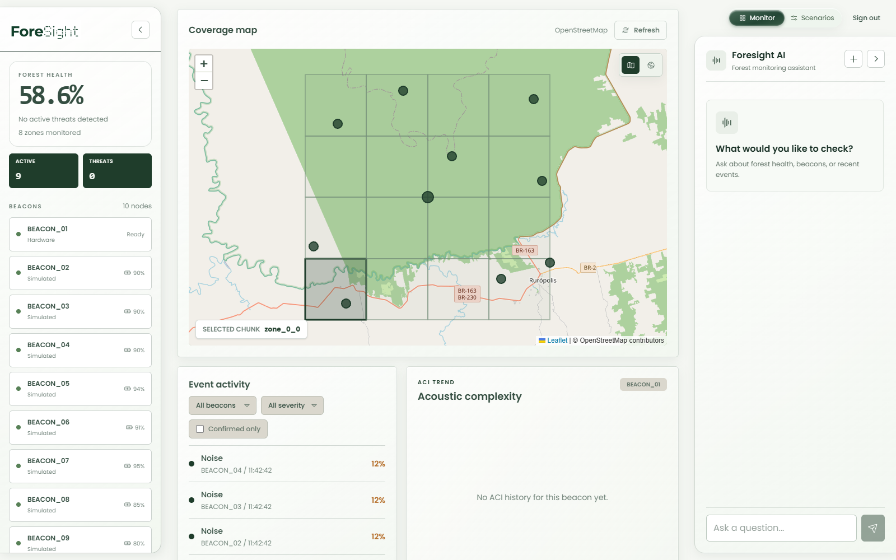

**Figure 10. Monitoring Dashboard with simulated beacons**

**Scenario Lab**

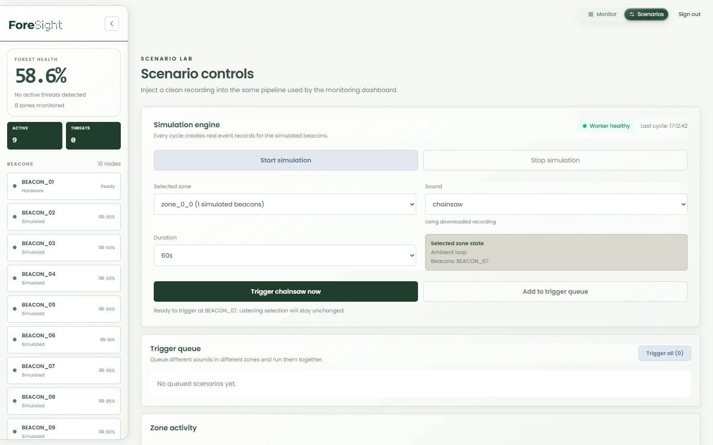

**Figure 11. Scenario Lab with simulated beacons**

<!-- Source PDF page 50 -->

**APPENDIX  |  HARDWARE AND 3D VIEWS**

## Foresight beacon hardware and 3D model

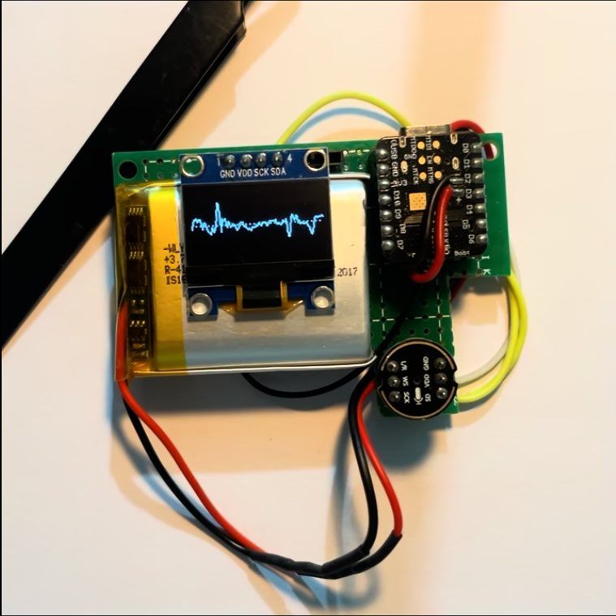

**Figure 12. Foresight beacon hardware**

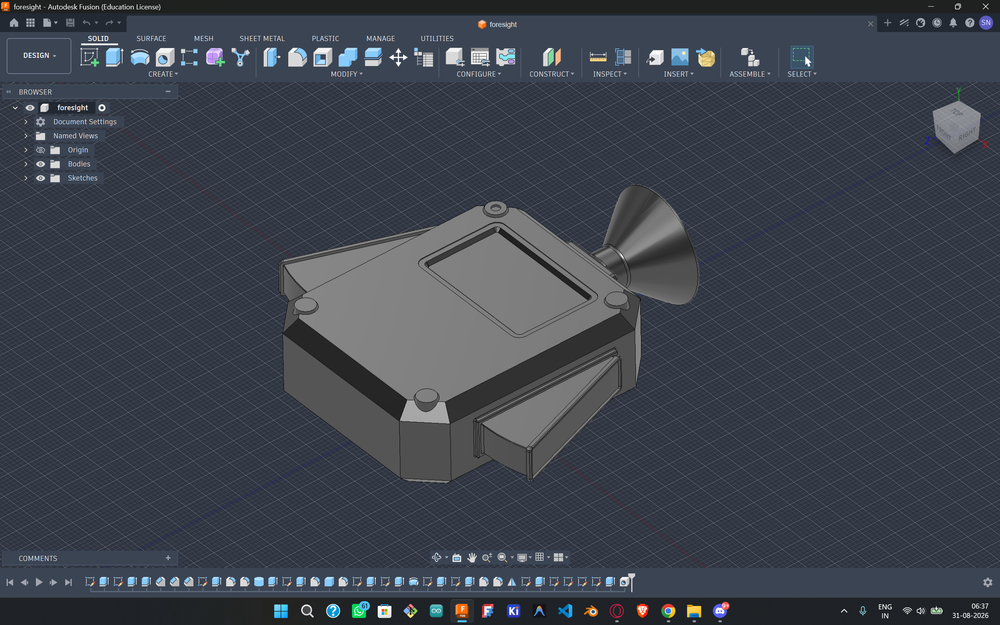

**Figure 13. Foresight beacon 3D model**
