# Foresight

*An acoustic monitoring prototype for forest conservation*

## Problem Statement

Forests provide habitat for wildlife, including endangered species. Conservation teams cannot continuously observe every part of a forest. An acoustic beacon can extend that coverage by recording local sound and drawing an officer's attention to possible disturbances such as chainsaw or vehicle activity. Ambient recordings also provide context about changes in the local soundscape.

Foresight processes recordings and beacon heartbeats into a live view for forest officers. Its objectives are to surface acoustic events for review, show which beacons and zones are reporting, and let an officer reproduce a scenario in a controlled demonstration. The backend classifies sound, calculates an Acoustic Complexity Index (ACI), scores detections, and correlates qualifying events across beacons. The dashboard presents the resulting events, coverage, and recordings available for replay.

The prototype supports simulated beacons and an ESP32 ingestion path. The map uses representative coordinates from the Tapajós National Forest region. The working-screen figures show a local simulation. Threat scores support investigation and the forest-health indicator tracks recent acoustic observations. Species identification, ecological validation, and field deployment at scale remain future work.

## Process Model

Foresight developed through an iterative prototype model. The first increment established the monitoring MVP. Later increments refined local playback, model deployment, simulation feedback, and the dashboard. Section 2.1 groups these increments using commit dates. The repository records when changes were committed. It provides limited evidence about time worked or formal sprint boundaries.

## 1. Requirement Analysis

### 1.1 Requirement identification

#### 1.1.1 Requirements

| ID | Functional requirement | Status |
| --- | --- | --- |
| FR-01 | Receive audio and heartbeat updates from configured beacons or the simulation workflow. | Implemented |
| FR-02 | Classify recordings, compute ACI, and calculate a fused detection score. | Implemented |
| FR-03 | Correlate qualifying detections across distinct beacons within the configured time window. | Implemented |
| FR-04 | Show the coverage map, beacon status, recent events, and acoustic health indicators. | Implemented |
| FR-05 | Allow an officer to inspect an event and replay a recording when one was saved. | Implemented |
| FR-06 | Run a selected sound in a populated simulation zone for a specified duration. | Implemented |
| FR-07 | Verify the officer's assigned ID and password and issue a JWT for access to protected monitoring functions. | Implemented |

| ID | Non-functional requirement | Status |
| --- | --- | --- |
| NFR-01 | Deliver live updates over WebSockets and retain REST endpoints for retrieving current and historical views. | Implemented |
| NFR-02 | Run uploaded audio processing off the API event loop. | Implemented |
| NFR-03 | Display coverage with the acoustic-health indicator and show when recent observations are unavailable. | Implemented |
| NFR-04 | Keep credentials in server configuration and reject invalid or expired authentication tokens. | Implemented |

#### 1.1.2 Working screens

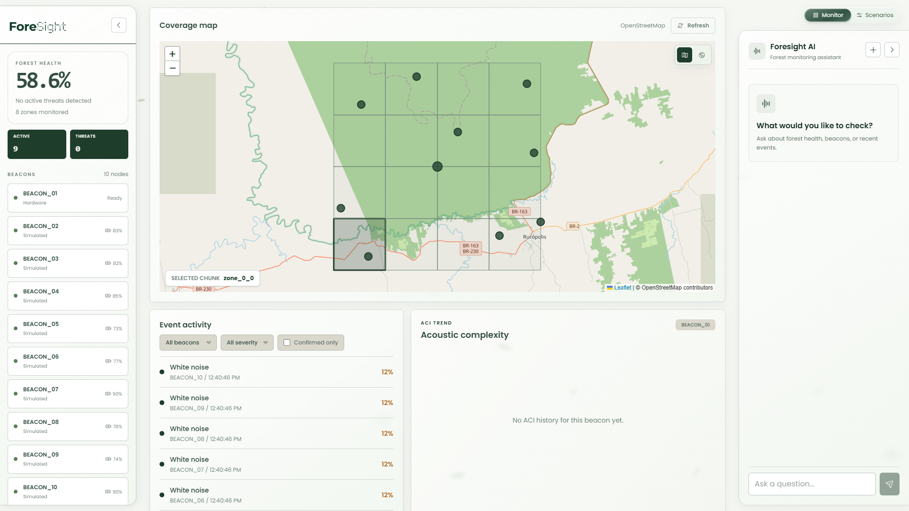

*Figure 1. Foresight dashboard showing acoustic health and beacon coverage in the local demonstration.*

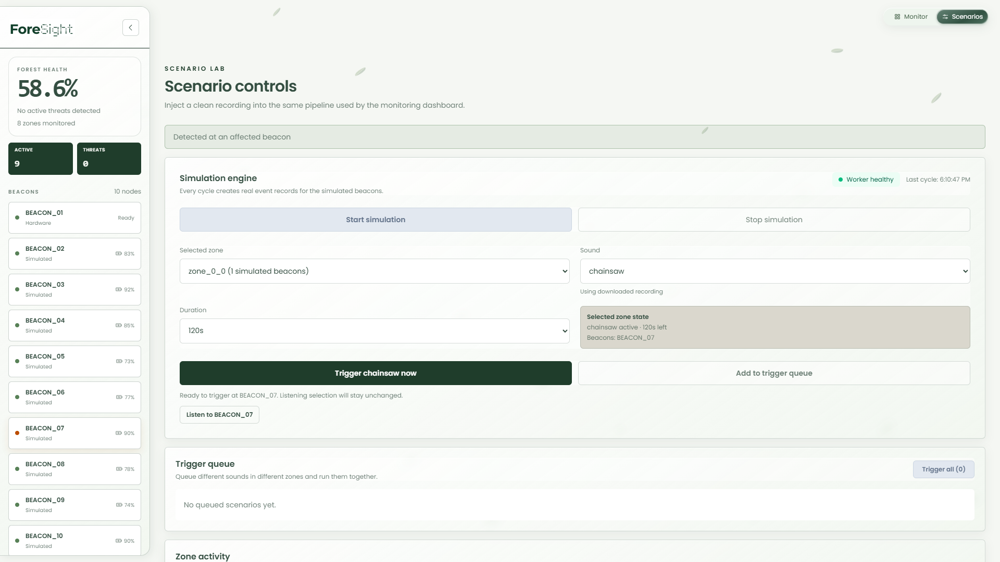

*Figure 2. Scenario Lab with a simulated chainsaw recording active in a selected zone.*

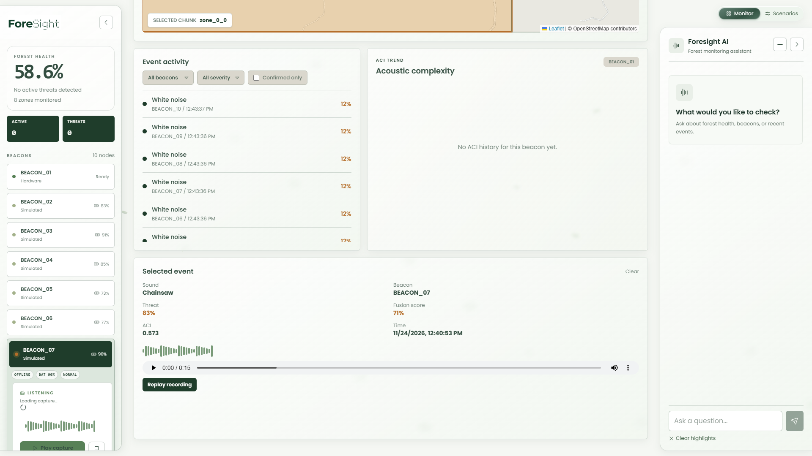

*Figure 3. Dashboard details for a detection from the chainsaw simulation in Figure 2. The event panel, normally hidden by desktop styling, was made visible for this capture.*

> **Hardware photo slot**  
> *Figure 4. Physical Foresight acoustic beacon. Photograph reserved for the final report.*

### 1.2 Level‑0 data-flow diagram

Figure 5 shows the monitoring system as one process. The physical beacon and scenario simulator supply audio and status. The forest officer requests monitoring data and receives dashboard results, alerts, and available audio.


*Figure 5. Foresight monitoring system boundary and external data flows.*

### 1.3 Level‑1 data-flow diagram

Figure 6 expands Foresight into four processes. Ingestion receives audio and heartbeats. Classification produces a scored event and saves qualifying audio. Correlation enriches event records. The monitoring process reads the records and serves the officer's dashboard and replay requests.

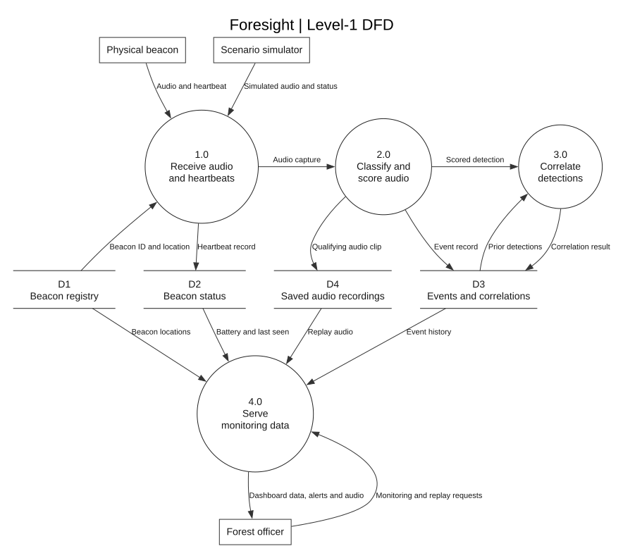

*Figure 6. Level‑1 processing and logical data stores for the working monitoring system.*

### 1.4 Data dictionary

**Table 1. Processes and external entities**

| ID or name | Role or transformation |
| --- | --- |
| 1.0 Receive audio and heartbeats | Accepts a capture or status update, uses beacon identity and location, and produces an audio capture or heartbeat record. |
| 2.0 Classify and score audio | Produces the sound class, confidence, ACI, and fused score. Stores the event and saves qualifying audio. |
| 3.0 Correlate detections | Combines qualifying events from distinct beacons within a time window and records the correlation result. |
| 4.0 Serve monitoring data | Returns status, locations, event history, and available replay audio through monitoring interfaces. |
| Physical beacon | Supplies environmental audio and heartbeat information. |
| Scenario simulator | Supplies demonstration recordings and simulated beacon status. |
| Forest officer | Requests monitoring information and reviews events and recordings. |

**Table 2. Logical data stores and representative fields**

| Store | Implementation | Representative data elements |
| --- | --- | --- |
| D1 Beacon registry | Beacon configuration and `beacons` | `beacon_id` (text), `latitude` and `longitude` (decimal coordinates), `is_real_hardware` (boolean) |
| D2 Beacon status | `beacon_status` | `beacon_id` (text reference), `last_seen` (timestamp), `battery_percentage` (number) |
| D3 Events and correlations | `events` and `correlations` | Event ID, beacon ID, timestamp, sound class, confidence, ACI, threat and final scores, confirmation flag, optional audio URL, related event IDs, and estimated proximity beacon ID |
| D4 Saved audio recordings | Local upload files with optional hosted storage | Audio bytes, capture or file identifier, media type, and replay URL reference stored on the event |

**Table 3. Data flows and structures**

| DFD flows | Structure |
| --- | --- |
| Audio and heartbeat, simulated audio and status | Audio upload with beacon ID and file bytes, or a heartbeat with beacon ID and battery percentage |
| Beacon ID and location, beacon locations, battery and last seen | Beacon identifier, coordinates, and latest available status as applicable |
| Audio capture, heartbeat record | Audio payload with capture metadata, or a timestamped beacon status update |
| Scored detection, event record, prior detections, event history | Event ID where assigned, beacon ID, timestamp, class, confidence, ACI, and scores |
| Correlation result | Related event IDs, estimated proximity beacon ID, and correlation timestamp |
| Qualifying audio clip, replay audio | Stored audio bytes or a URL that can be resolved for playback |
| Monitoring and replay requests, dashboard data, alerts and audio | Query, selected event or replay reference, and the corresponding status, summary, event, or audio response |

### 1.5 Use-case diagram

The forest officer monitors coverage, inspects events, replays saved recordings, and runs controlled simulations. Figure 7 also includes sign-in, which is described in Section 1.7 as an implemented feature.

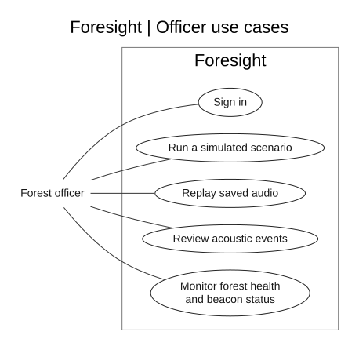

*Figure 7. Forest officer use cases.*

### 1.6 Use-case templates

**Table 4. Core officer workflows**

| Field | UC‑01 Monitor forest and beacon status | UC‑02 Review an acoustic event | UC‑03 Run a simulation |
| --- | --- | --- | --- |
| Primary actor | Forest officer | Forest officer | Forest officer |
| Trigger | Open Dashboard | Select an event in the event feed | Open Scenario Lab and trigger a sound |
| Preconditions | Backend is reachable and beacon configuration is available | An event is present in the feed | Simulation is running and the chosen zone contains a simulated beacon |
| Main flow | View coverage, beacon status, and recent acoustic health | Inspect the class, beacon, ACI, and scores. Replay audio when available. | Choose a populated zone, sound, and duration. Trigger the scenario and observe resulting detections. |
| Alternate flow | The dashboard shows a waiting state if there are no recent observations. | The event remains inspectable when no recording was saved. | An unpopulated zone or stopped worker prevents the trigger. |
| Postcondition | The officer can identify reporting zones and review current indicators. | The officer can review the evidence available for the selected event. | The selected simulated beacons feed the analysis pipeline for the scenario. |
| Requirements | FR‑01, FR‑04, NFR‑03 | FR‑02, FR‑03, FR‑05 | FR‑06 |

### 1.7 Login module and credential storage

The officer enters the configured login ID and password. FastAPI compares both values with server-side settings and issues a signed bearer JWT valid for one hour. Authentication uses server configuration. The monitoring database stores beacon and event data.

### 1.8 Sequence diagram

Figure 8 shows credential verification, login failures, token storage, and the first protected session check. The browser restores a valid session within the same tab and clears it on sign-out or authentication failure.

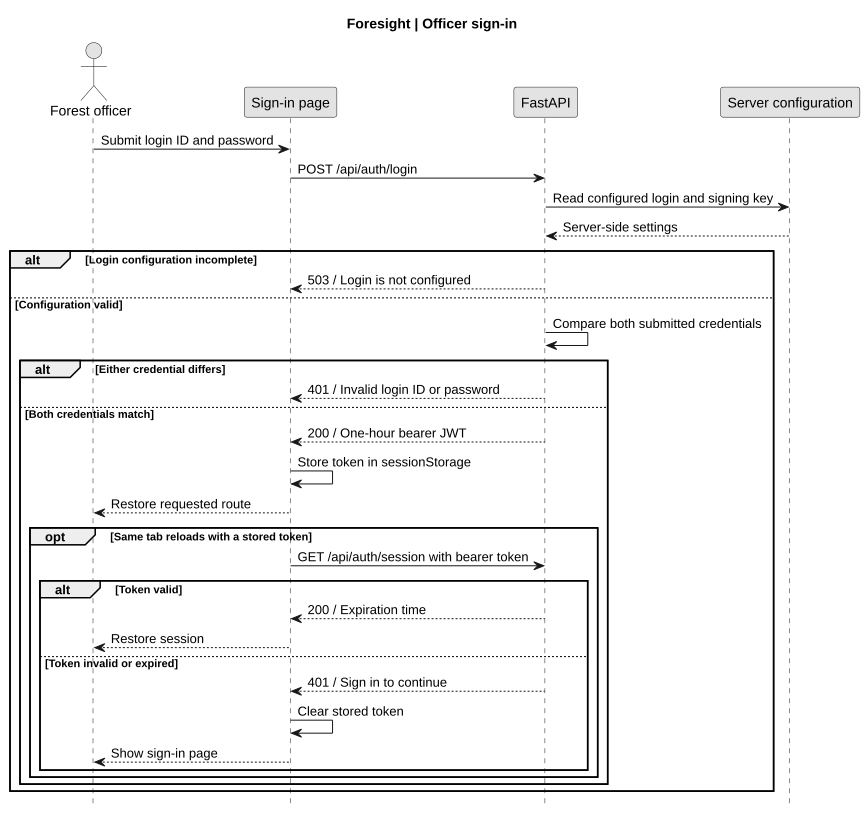

*Figure 8. Officer sign-in and protected session check.*

### 1.9 Software requirements specification

#### 1.9.1 Introduction

Foresight supports acoustic event review and forest monitoring demonstrations. The primary user is a forest officer. The system scope covers acquisition, processing, persistence, and presentation of acoustic and beacon data.

#### 1.9.2 Overall description

Physical beacons submit recordings and heartbeat data. The Scenario Lab produces controlled sound inputs for simulated beacons. A FastAPI service persists events and status in SQLite or PostgreSQL and exposes monitoring data to the React dashboard. Qualifying recordings can be served locally or through configured storage. The officer access flow is described in Section 1.7.

#### 1.9.3 Specific requirements

The requirements baseline is FR‑01 through FR‑07 and NFR‑01 through NFR‑04 in Section 1.1. Tables 1–3 define the associated data inputs, outputs, and stores. Table 4 connects the core officer workflows to requirement IDs. The monitoring interface uses HTTP for queries, ingestion, and simulation controls, and WebSockets for live updates.

## 2. Project Management

### 2.1 Project timeline

Figure 9 shows three periods of recorded repository activity. The horizontal scale is continuous, with the gap between the September and November commits visible.

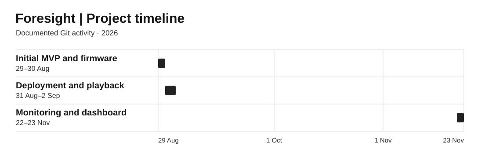

*Figure 9. Foresight development increments reconstructed from dated Git commits.*

**Table 5. Documented development increments**

| Commit dates (2026) | Recorded work | Representative commits |
| --- | --- | --- |
| 29–30 August | Initial MVP, OLED firmware, live audio, and assistant improvements | `1f3b38a`, `59f3752`, `cae6d0b` |
| 31 August–2 September | YAMNet deployment, playback synchronization, and simulation feedback | `157812f`, `28506d7`, `1ad8164` |
| 22–23 November | Monitoring, dashboard navigation, and sidebar refinements | `f11939f`, `cb9dbbd`, `6796f51` |

### 2.2 Function point analysis

The estimate covers the monitoring boundary in Figure 6. It counts user-recognizable transactions and logical data groups. Physical and simulated audio and heartbeats count as alternate sources for the same inputs. Scenario Lab controls and JWT sign-in are excluded from this estimate. Average-complexity weights are applied uniformly as a planning assumption.

The course guide assigns Pressman and Maxim (9th ed.), §§25.6.1 and 25.6.4, for software sizing and function-point estimation. The method starts with a weighted count and applies an adjustment based on 14 characteristics rated from 0 to 5. [Course guidelines, Unit 4](../reference/guidelines/guidelines.pdf#page=1) · [Pressman and Maxim, pp. 511 and 514–515](../reference/pressman-maxim-software-engineering-9e.pdf#page=547)

**Table 6. Unadjusted function point count**

| Category | Functions or logical groups | Count | Weight | Points |
| --- | --- | ---: | ---: | ---: |
| External inputs (EI) | Audio ingestion and heartbeat update | 2 | 4 | 8 |
| External outputs (EO) | Derived dashboard summary and live alerts | 2 | 5 | 10 |
| External inquiries (EQ) | Beacon status and location, event history and detail, and audio replay | 3 | 4 | 12 |
| Internal logical files (ILF) | Beacon registry (D1), beacon status (D2), events and correlations (D3), and saved recordings (D4) | 4 | 10 | 40 |
| External interface files (EIF) | None within the assessed boundary | 0 | 7 | 0 |
| **Total** | **Unadjusted function points (UFP)** | **11** | | **70** |

The prototype ratings below are engineering estimates. They give more weight to live communication, online input, and online updates than to installation or distributed backend processing.

**Table 6A. Estimated function point adjustment factors**

| Adjustment factor | Rating | Adjustment factor | Rating |
| --- | ---: | --- | ---: |
| Backup and recovery | 2 | Online updates | 4 |
| Data communications | 4 | Information domain complexity | 3 |
| Distributed processing | 0 | Internal processing complexity | 3 |
| Performance sensitivity | 3 | Reuse | 2 |
| Existing operating environment | 2 | Conversion and installation | 1 |
| Online input | 4 | Multiple installations | 1 |
| Transactions across screens | 2 | Ease of change | 3 |

The ratings sum to **34**. The adjustment factor is **0.65 + 0.01 × 34 = 0.99**, giving **70 × 0.99 = 69.30 adjusted FP**.

### 2.3 Effort, cost, and time

**Table 7. Planning estimates for the assessed monitoring scope**

| Measure | Calculation | Estimate |
| --- | --- | ---: |
| Effort | 69.30 FP ÷ 10 FP per person-month | 6.93 person-months |
| Labour cost | 6.93 person-months × ₹50,000 per developer-month | ₹3,46,500 |
| Calendar duration | 6.93 person-months ÷ 2 full-time developers | About 3.47 months |

The course assignment specifies a developer salary of ₹50,000 per month and average productivity of 10 FP per person-month. Two full-time developers is an assumed staffing scenario. Using the 70-point unadjusted count as a comparison gives 7 person-months, ₹3,50,000 in labour, and 3.5 calendar months with the same staffing. These estimates describe the assessed monitoring scope and are separate from the repository timeline in Figure 9.

### 2.4 Risk table

Likelihood and impact are qualitative planning judgments.

**Table 8. Prototype risks and mitigations**

| Risk | Likelihood | Impact | Mitigation |
| --- | --- | --- | --- |
| Classifier confuses similar sounds or misses a disturbance | Medium | High | Preserve scores and qualifying recordings for officer review. Use cross-beacon correlation as supporting context. |
| Incomplete beacon coverage distorts the apparent forest condition | High | High | Show reporting coverage with the health score and leave unobserved zones unscored. |
| Network delays or dropped audio interrupt observations | Medium | High | Watch heartbeat age and capture gaps. Keep capture and transmission decoupled and monitor queue congestion. |
| Prototype wiring or battery details remain unverified | Medium | Medium | Verify the physical build against the firmware, then record pin assignments and bench measurements. |
| Hosted model, database, or storage services become unavailable | Medium | Medium | Maintain a local demo path with SQLite, local recordings, and the available classifier fallback. |

## 3. Design Engineering

### 3.1 Architectural design

The physical beacon sends audio and battery heartbeats over Wi-Fi. The backend's scenario simulator supplies alternative captures to the same analysis pipeline. FastAPI exposes ingestion and monitoring operations through REST and sends live updates over a WebSocket. SQLAlchemy persists beacon and event records in SQLite or PostgreSQL. Qualifying audio is saved locally and can be uploaded to Supabase Storage when configured. Figure 10 shows these communication boundaries.

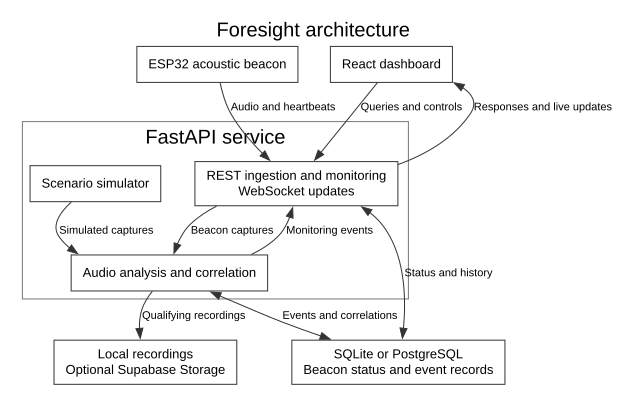

*Figure 10. Foresight prototype architecture.*

Figure 11 follows one capture. The backend decodes and resamples the audio, classifies it with YAMNet or the available fallback, and computes ACI and a detection score. It stores the event and saves qualifying audio. Correlation checks for qualifying events from other beacons in a configured time window. The stored classifier confidence is used as a proxy when selecting a beacon for the proximity estimate. The dashboard receives the completed event and provides replay when audio was saved.

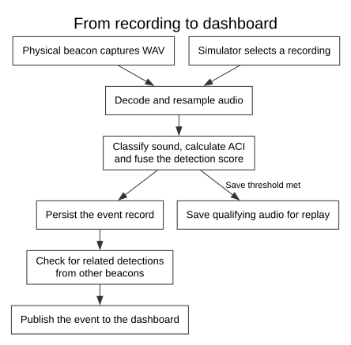

*Figure 11. Processing and delivery of one recording.*

#### 3.1.1 Beacon signal processing

The firmware receives signed 32-bit I2S samples and shifts them right by 16 bits. The upload branch applies a fixed, tunable noise floor, multiplies by digital gain, and clamps the result to the signed 16-bit PCM range of −32,768 to 32,767. A bounded queue feeds a separate network task that transmits 16 kHz mono WAV. When congestion fills the queue, the firmware can drop chunks and log the condition.

The OLED branch selects the signed peak for each display column, applies the fixed floor, and scales the waveform around the centerline. Adaptive gating and high-pass filtering remain future refinements. Figure 12 traces the two implemented paths.

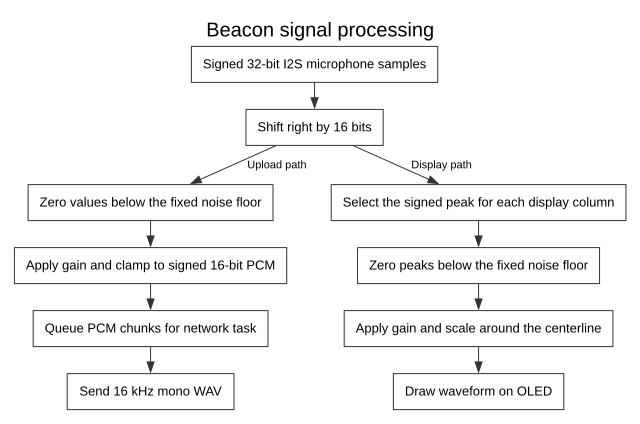

*Figure 12. PCM upload and OLED display paths from the shared I2S input.*

#### 3.1.2 Acoustic complexity and threat scoring

The backend divides audio into complete 512-sample frames and takes the magnitude of the real FFT for each frame. For frequency bin *k*, let *X(t,k)* denote the magnitude at frame *t* and let *T* be the number of complete frames.

```text
Change(k) = sum from t = 2 to T of |X(t,k) − X(t−1,k)|
Total(k)  = sum from t = 2 to T of X(t,k)
ACI       = clamp(mean over k of Change(k) / Total(k), 0, 1)
```

Bins with total magnitude at or below 10⁻⁸ contribute zero. Audio with fewer than two complete frames also yields zero. For the threat score, the backend takes the largest confidence multiplied by class weight among threat classes meeting the confidence threshold. If no class qualifies, the threat score is zero.

```text
Relative ACI drop = max(0, baseline − ACI) / baseline
Final score       = clamp(0.7 × threat score + 0.3 × relative ACI drop, 0, 1)
```

For an illustrative chainsaw detection, confidence **0.80** and class weight **0.90** give a threat score of **0.72**. An ACI of **0.24** against an illustrative baseline of **0.30** gives a relative drop of **0.20**. The fused event score is **0.564**, or **56.4%**.

The dashboard's forest-health indicator averages the latest baseline-normalized beacon readings in each observed zone. It deducts up to 0.35 from the zone score, scaled by the strongest qualifying recent threat, then clamps the result. The dashboard averages the observed zone scores with equal weight and displays coverage alongside the result. A zone without a recent observation has no score.

### 3.2 Structure chart

Figure 13 groups the prototype into three modules. Firmware manages acquisition, the OLED, and network uploads. The backend separates ingestion, simulation, acoustic analysis, correlation, and persistence. The frontend provides the monitoring dashboard and Scenario Lab.

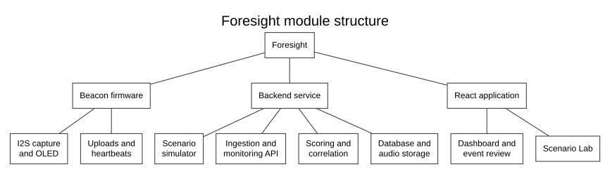

*Figure 13. Module hierarchy for the working prototype.*

### 3.3 Login pseudocode

The login route validates the request schema before entering its handler. The handler and its configuration helper follow these steps.

```text
D1–D3: Check that the configured ID and password are present
       and the signing key has at least 32 encoded bytes.
       If any configuration check fails, return 503.
       Compare submitted ID and password with the configured values.
D4–D5: If either comparison fails, return 401.
       Otherwise issue a signed JWT and return 200.
```

## 4. Coding

### 4.1 Login route

The implemented endpoint is `POST /api/auth/login`. The following extract shows the route's credential check after it has obtained a valid signing key.

```python
valid_id = compare_digest(payload.login_id.encode(), settings.foresight_login_id.encode())
valid_password = compare_digest(
    payload.password.get_secret_value().encode(),
    settings.foresight_login_password.get_secret_value().encode(),
)
if not (valid_id and valid_password):
    raise unauthorized('Invalid login ID or password')
```

A successful response contains `access_token`, `token_type`, and `expires_in`. The token carries issuer, subject, issue time, and expiration claims. The response uses `Cache-Control: no-store`.

### 4.2 JWT session check

`GET /api/auth/session` returns the expiration time after token verification. The backend requires an HS256 signature, the configured subject, the application issuer, and the required timestamps. Protected REST routes use the bearer token. The WebSocket sends the token as its first message and receives `auth.ready` when verification succeeds.

### 4.3 Sign-in page and API helper

The React sign-in form sends `login_id` and `password`. The API helper stores the access token in the current tab's `sessionStorage` and adds the bearer header to authenticated HTTP requests.

### 4.4 Credential configuration

**Table 9. Server-side login configuration**

| Setting | Purpose |
| --- | --- |
| `FORESIGHT_LOGIN_ID` | Assigned login ID and JWT subject |
| `FORESIGHT_LOGIN_PASSWORD` | Server-side password used for comparison |
| `FORESIGHT_JWT_SECRET` | Server-side signing key, at least 32 encoded bytes |

### 4.5 End-to-end walkthrough

A signed-out user opening a protected page goes to sign-in. After successful authentication the browser restores the requested route. Reloading the same tab restores a valid session, which is rechecked with the API. Sign-out, an expired session, or a protected API response with status 401 clears the stored token and returns the browser to sign-in.

## 5. Testing

The tests ran on 24 November 2026 on Windows with isolated SQLite data, a local FastAPI service, the Vite production preview, and headless Chrome. Browser and manual checks used test-only credentials. The [sanitized execution evidence](testing/execution-evidence.txt) lists individual automated results.

### 5.1 White-box testing

Figure 14 covers the login handler and its configuration helper for a request that passes schema validation. It counts each short-circuit predicate as a separate decision. The handler computes both credential comparisons before evaluating the combined result. Schema rejection and unexpected runtime exceptions are outside this graph.

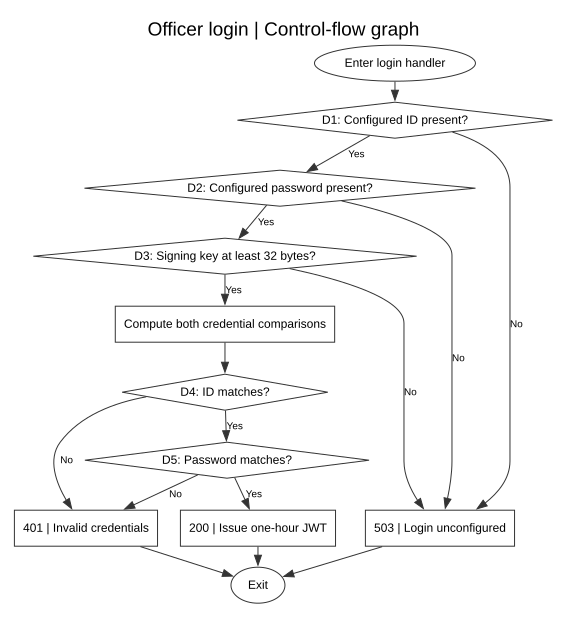

*Figure 14. Login control flow with five decisions and a common exit.*

There are 11 nodes, 15 edges, and one connected component. Cyclomatic complexity is **15 − 11 + 2 = 6**, which also equals five decisions plus one.

**Table 10. Independent paths through the login handler**

| Path | Decisions in order | Outcome |
| --- | --- | --- |
| P1 | D1 No | 503, configured ID missing |
| P2 | D1 Yes → D2 No | 503, configured password missing |
| P3 | D1 Yes → D2 Yes → D3 No | 503, signing key too short |
| P4 | D1–D3 Yes → D4 No | 401, incorrect ID |
| P5 | D1–D4 Yes → D5 No | 401, incorrect password |
| P6 | D1–D5 Yes | 200, issue JWT |

These paths are derived from the code. The recorded unconfigured-login test exercises P3. P1 and P2 remain designed paths without individual execution evidence.

### 5.2 Black-box testing

**Table 11. Test cases and observed outcomes**

| ID | Case | Expected | Observed | Verdict |
| --- | --- | --- | --- | --- |
| FT-01 | Valid sign-in and session | Login succeeds and the session expiry is in the future. | Login returned 200 and session reported a future expiry. | Pass |
| FT-02 | Wrong ID or password | Both requests receive the same generic 401 response. | Both requests returned 401 with the same credential error. | Pass |
| FT-03 | Required fields | Blank browser form is invalid and omitted API fields return 422. | Two required inputs, blank form invalid, and three API responses returned 422. | Pass |
| FT-04 | Unconfigured login | Login returns 503 and protected events return 401. | Both statuses matched. | Pass |
| FT-05 | Rejected session claims | Protected REST requests return 401 and the WebSocket closes with 4401 when authorization fails or expires. | REST and WebSocket checks matched the expected statuses. | Pass |
| FT-06 | Direct route, reload, and sign-out | Requested route is restored, reload retains a valid session, and sign-out returns to login. | The browser assertions passed. | Pass |
| FT-07 | Browser token expiry | The sign-in screen appears and the stored token is cleared. | Both checks passed. | Pass |
| FT-08 | Protected request rejection | The browser clears the session and shows sign-in. | Both checks passed. | Pass |
| FT-09 | Protected audio and replay | Guest request is denied, signed-in request succeeds, and audio advances. | API access checks and browser playback passed. | Pass |
| FT-10 | Scenario capture and continuity | Capture arrives and playback survives subsequent captures and route switches. | The browser checks passed. | Pass |
| FT-11 | Forest health component | The assertions uniquely identify the waiting state and zone impact. | Two Vitest assertions found multiple matching text elements. | Fail |
| FT-12 | Forest health display | Expected headline scores or waiting state appear. | Three browser checks could not locate the expected headline element. | Fail |
| FT-13 | Dashboard navigation regression | The expected page content and controls remain visible. | Two browser visibility assertions timed out. The separate repeated-route controls check passed. | Fail |

**Table 12. Automated suite totals**

| Suite | Passed | Failed | Total |
| --- | ---: | ---: | ---: |
| pytest | 63 | 0 | 63 |
| Vitest | 25 | 2 | 27 |
| Playwright | 9 | 5 | 14 |
| **Total** | **97** | **7** | **104** |

The browser login and protected replay checks passed. The failures concern dashboard health assertions and navigation visibility. They remain open for investigation. Jira created 13 work items in the Foresight project (`KAN`) on 24 November 2026. The cases are referenced here by their IDs, FT-01 through FT-13. The [Jira import CSV](testing/foresight-jira-test-results.csv) maps each documented case to its requirement, steps, observed result, and evidence. The [desktop sign-in capture](testing/login-screen.png) shows the blank form used for the required-field check.

## Technical references

- [Foresight documentation](../README.md)
- [Backend routes and monitoring interfaces](../backend/app/main.py)
- [Database models](../backend/app/models.py)
- [Audio processing and classification](../backend/app/audio.py)
- [Event scoring and correlation pipeline](../backend/app/pipeline.py)
- [Forest health calculation](../backend/app/health.py)
- [Beacon firmware and waveform display](../firmware/foresight_beacon/foresight_beacon.ino)
- [Threat class weights and score fusion](../backend/app/scoring.py)
- [Implemented login and token verification](../backend/app/auth.py)
- [Browser authentication gate](../frontend/src/components/AuthGate.jsx)
- [DSC-15 Software Engineering course guidelines and practical requirements](../reference/guidelines/guidelines.pdf)
- [Pressman and Maxim, *Software Engineering: A Practitioner’s Approach*, 9th ed.](../reference/pressman-maxim-software-engineering-9e.pdf)
